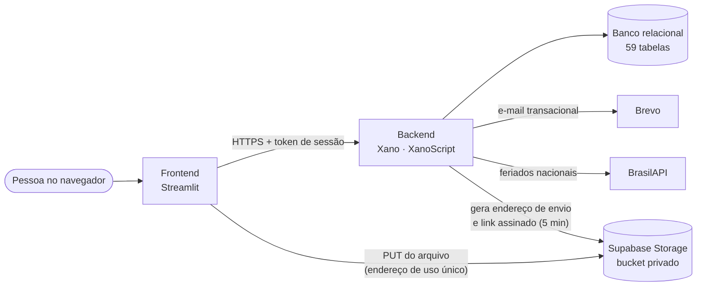

<div align="center">

# ConectaRH

**Plataforma de gestão de pessoas que centraliza o ciclo de vida do colaborador**
da admissão ao desligamento, com autorização por perfil, decisões auditáveis e LGPD desde o desenho.

[](https://github.com/leonardo-sferreira/conectahr/releases)
[](https://github.com/leonardo-sferreira/conectahr/actions/workflows/validar.yml)


[Funcionalidades](#funcionalidades) · [Arquitetura](#arquitetura) · [Stack](#stack) ·
[Segurança e LGPD](#segurança-e-lgpd) · [Qualidade](#qualidade-e-testes) · [Como rodar](#como-rodar) ·
[Roadmap](#roadmap)

</div>

---

## Sobre o projeto

RH, gestores e colaboradores costumam depender de planilhas, e-mail e controles paralelos para
ponto, documentos, férias, avaliações e desligamento. O **ConectaRH** reúne essas rotinas numa única
plataforma, com quatro perfis de acesso (**Admin, RH, Gestor e Colaborador**), escopo por departamento
e hierarquia, e auditoria de toda decisão relevante: quem fez, o quê, quando e por quê.

Um dos pilares é o **motor de regras trabalhistas**: jornada, banco de horas e férias são resolvidos por
uma matriz de contrato (CLT, estágio, aprendiz, temporário, PJ) que pode ser sobrescrita por norma legal,
instrumento coletivo ou exceção individual, sempre com o histórico de qual regra foi aplicada.

> **Trabalho acadêmico**, desenvolvido em grupo. Bases legais, prazos de guarda e regras trabalhistas
> são referências de estudo, a confirmar com o jurídico de quem for usar o sistema de verdade.

### Em números

| | |
|---|---|
| **Backend** | 59 tabelas, 32 funções e 228 endpoints em 10 grupos de API (223 autenticados, todos com a guarda de acesso conferida no CI) |
| **Frontend** | 22 telas Streamlit, 20 módulos de regra de tela testáveis sem rede, tema claro e escuro |
| **Especificação** | Spec principal com 70 requisitos e 217 cenários; 11 changes arquivadas e 3 em andamento no OpenSpec |
| **Testes** | 20 suítes automatizadas (909 verificações) no pipeline, mais testes por HTTP contra o backend real, por perfil |
| **Documentação** | Regras de negócio mapeadas do código, modelo de domínio, LGPD (RIPD, operadores, retenção) e evidências |

---

## Funcionalidades

### Para todos

- **Login em dois passos:** senha e código de acesso por e-mail (guardado como hash), token de 1 hora
  ligado a uma sessão, bloqueio por tentativas, troca de senha no primeiro acesso e redefinição.
- **Início** com indicadores, comunicados, aniversariantes e atalhos; **sino de notificações** com
  "abrir", "marcar como lida" e "marcar todas".
- **Meu perfil:** dados pessoais, contato, cargo, conta bancária e pedidos de alteração cadastral.
- **Organograma público e navegável:** cartões com nome, cargo e área; clicar numa pessoa mostra quem
  está acima (superior direto) e quem está abaixo; níveis hierárquicos definidos por cada empresa.
- **Comunicados e FAQ**, **onboarding** do primeiro acesso com as etapas por responsável e
  **aviso de privacidade** com e sem login.

### Colaborador

- **Ponto no modelo REP-P:** marcação sem limite de quantidade, comprovante em PDF a cada marcação,
  espelho mensal em formato de planilha (art. 84 da Portaria 671/2021), saldo diário com tolerância de
  10 minutos, horas positivas e negativas, aviso de descanso entre jornadas (11h) e pedido de ajuste
  pela célula da marcação: incluir, corrigir o horário ou desconsiderar, sempre com motivo.
- **Férias** com calendário do mês (feriados nacionais pela BrasilAPI, facultativos e férias da equipe).
- **Documentos:** anexar o arquivo (PDF ou foto do celular, até 10 MB) preenchendo só os campos de cada tipo
  (RG com órgão emissor e UF, CNH com categoria e validade, CPF só o número…), validados e conferidos pelo RH.
- **Pagamento:** holerites e informes de rendimentos, só para o dono.
- **Benefícios:** cada benefício ativo com a descrição, os links da operadora e os materiais do RH.
- **Configurações → Privacidade:** preferências, exportação dos próprios dados e pedido LGPD.

### Gestor

- **Central de Pendências:** decide férias (com conferência de conflitos) e correções de ponto da equipe.
- **Folha de ponto** da equipe pela hierarquia (superior direto), com ajuste direto auditado.
- Recebe aviso de pedido novo e de descanso entre jornadas abaixo do mínimo.

### RH e Admin

- **Colaboradores:** admissão com cargo filtrado pelo departamento, criação de acesso e vínculo de ficha.
- **Estrutura da empresa:** feriados (com importação dos nacionais), níveis hierárquicos e **cadastro de
  cargos** com senioridade (Júnior, Pleno, Sênior, Especialista), departamento, nível e salário base.
- **Conferência de documentos:** os dados preenchidos ao lado do arquivo, que abre em um clique, e a matriz de
  **documentos obrigatórios por contrato** (CLT, temporário, aprendiz, estágio e PJ) já pré-definida.
- **Benefícios:** catálogo com descrição, links e materiais anexados; vínculo por pessoa com valor e desconto.
- **Ausências** e **Solicitações ao RH** (com a alteração cadastral aplicada).
- **Usuários e perfis** (Admin): criar, trocar perfil, ativar, desativar e vincular à ficha.

---

## Arquitetura



- **O backend decide tudo:** regras de negócio, autorização por perfil e escopo, e persistência. O
  frontend nunca é mecanismo de segurança; o menu por perfil é só conveniência.
- **Guarda replicada em cada endpoint:** usuário ativo, senha definitiva e sessão válida, nessa ordem e
  antes da primeira escrita. Um verificador estático confere os 223 endpoints autenticados a cada PR.
- **Arquivos fora do Xano:** o plano gratuito não aceita upload, então o arquivo vai do Streamlit direto
  para um bucket privado do Supabase, por um endereço de uso único gerado pelo Xano. A chave do Supabase
  fica só no ambiente do Xano; o arquivo abre por link assinado de 5 minutos, com auditoria.
- **Só inclusão onde a lei pede:** marcações de ponto (ARP), tratamentos, banco de horas e histórico
  profissional nunca são editados nem apagados; correção é um novo registro.

Detalhes em [`docs/arquitetura.md`](docs/arquitetura.md) e conceitos em [`docs/domain-model.md`](docs/domain-model.md).

---

## Stack

| Camada | Tecnologia | Uso no projeto |
|---|---|---|
| Backend | [Xano](https://xano.com) + XanoScript | API, banco relacional e regras, versionados em `xano-workspace/` |
| Frontend | [Streamlit](https://streamlit.io) 1.64 (Python) | Telas por perfil, tema próprio em `theme.py`, fontes servidas pelo próprio app |
| Arquivos | [Supabase Storage](https://supabase.com/storage) | Bucket privado `documentos` (São Paulo), links assinados |
| E-mail | [Brevo](https://www.brevo.com) | Código de acesso, redefinição de senha e avisos (outbox com tentativas) |
| Dados públicos | [BrasilAPI](https://brasilapi.com.br) | Importação dos feriados nacionais |
| PDF | [fpdf2](https://py-pdf.github.io/fpdf2/) | Comprovante de registro de ponto |
| Design | [Figma](https://www.figma.com/design/fph1M5tB4rA4gqfIysSmkn) | Design system, protótipo navegável (claro e escuro) e fluxos F01 a F39 |
| Especificação | [OpenSpec](https://github.com/Fission-AI/OpenSpec) | Explorar → Propor → Revisar → Aplicar → Arquivar |
| CI | GitHub Actions | Pipeline **Validar** em todo Pull Request |

---

## Regras de negócio em destaque

O mapa completo, com o arquivo de cada regra, está em [`docs/regras-de-negocio.md`](docs/regras-de-negocio.md).

| Domínio | Regras |
|---|---|
| **Acesso** | Ninguém decide um pedido em que é o próprio colaborador; o Gestor só vê o próprio departamento ou quem tem a ele como superior direto; sessão revogável por dispositivo |
| **Ponto (REP-P)** | NSR sequencial e hash SHA-256 encadeado; o dia é o dia civil de Brasília; jornada aberta vira INCOMPLETO na virada, sem marcação automática; saldo com tolerância de 10 min (CLT art. 58 §1º); descanso de 11h avisado, nunca bloqueado (art. 74); o dia de hoje só é ajustável a partir de amanhã |
| **Férias e ausências** | Antecedência, limite proporcional ao tempo de casa e conferência de conflito na equipe; feriados e facultativos no calendário |
| **Documentos** | Campos próprios de cada tipo, validados no backend (CPF igual ao da ficha, CNH com 11 dígitos, comprovante de residência dos últimos 90 dias); só PDF, JPG e PNG de até 10 MB; arquivo em bucket privado com nome aleatório; abertura só pelo dono, RH ou Admin, sempre auditada; prazo de retenção por tipo de documento |
| **Cargos** | Nome do cargo é o título da carteira com a senioridade ("Analista de Contas a Pagar Pleno"); único; na admissão, só os cargos do departamento escolhido |
| **Notificações** | Pedido novo avisa quem decide; decisão avisa quem pediu; mudança que afeta a pessoa avisa a pessoa |

---

## Segurança e LGPD

- **Autenticação:** senha com hash, código de acesso por e-mail com hash e *pepper*, token de 1 hora
  ligado a uma sessão, revogação em massa, bloqueio após tentativas e alerta de acesso suspeito.
- **Autorização:** guarda replicada em cada endpoint e conferida no CI; bloqueio de autoaprovação;
  o comprovante de ausência (dado de saúde) nunca chega ao Gestor; a conta bancária só é alterada pelo titular.
- **Auditoria:** toda escrita grava autor, ação, recurso, registro e resultado, com dado pessoal mascarado
  (CPF, conta, salário, e-mail e telefone nunca inteiros); toda abertura de arquivo sensível é registrada.
- **Privacidade:** exportação dos dados do titular, pedido LGPD com prazo de 15 dias, preferências de
  exibição, regras para menores de 18 anos e anonimização de desligados respeitando os prazos de guarda.
- **Sem rastreio de terceiros:** fontes servidas pelo próprio app (sem Google Fonts), swagger desligado.
- **Repositório público sem segredos:** o pipeline procura chaves versionadas a cada PR.

Documentação em [`docs/lgpd/`](docs/lgpd/): [aviso de privacidade](docs/lgpd/aviso-de-privacidade.md),
[registro de operações](docs/lgpd/registro-de-operacoes.md), [RIPD](docs/lgpd/ripd.md),
[operadores](docs/lgpd/operadores.md) (Xano, Brevo, Supabase, hospedagem), [retenção](docs/lgpd/retencao.md),
[legítimo interesse](docs/lgpd/legitimo-interesse.md) e [plano de incidentes](docs/lgpd/plano-de-incidentes.md).

**Encarregado pelo tratamento de dados:** a definir. **Contato:** `privacidade@conectarh.com` (provisório).

### Ponto eletrônico

O ponto segue os requisitos técnicos do **REP-P** (Portaria MTP nº 671/2021): ARP só de inclusão, NSR,
hash encadeado, comprovante, espelho do art. 84 e tratamentos com motivo. Ele **não vale como REP-P para a
fiscalização**: faltam o registro no INPI, a assinatura ICP-Brasil e o atestado técnico, e a geração do
AFD e do AEJ ainda está em construção. Detalhes em [`docs/ponto/rep-p.md`](docs/ponto/rep-p.md).

---

## Qualidade e testes

O pipeline **Validar** ([`.github/workflows/validar.yml`](.github/workflows/validar.yml)) roda em todo Pull Request:

1. sintaxe de todo o Python do frontend e das ferramentas;
2. **guarda de acesso** dos 223 endpoints autenticados do Xano (`tools/checar_endpoints.py`), incluindo a
   proibição de editar ou apagar as tabelas só de inclusão do ponto;
3. fontes servidas pelo próprio app, sem Google Fonts (`tools/checar_fontes_locais.py`);
4. teste de fumaça do frontend;
5. **20 suítes de tela, com 909 verificações**, usando o `AppTest` do Streamlit e uma API simulada, sem rede e sem dado real;
6. busca de segredos versionados.

| Suíte | Verificações | Suíte | Verificações |
|---|---:|---|---:|
| Entrada e login (F01) | 52 | Ponto (Hoje) | 41 |
| Onboarding | 52 | Espelho de ponto mensal | 95 |
| Privacidade e Documentos | 108 | Folha de ponto e hierarquia | 46 |
| Conferência de documentos | 55 | REP-P (hash e cadeia) | 7 |
| Meu perfil | 60 | Comprovante em PDF | 18 |
| Férias | 51 | Benefícios | 39 |
| Pagamento | 40 | Organograma | 33 |
| Central de Pendências e Ausências | 64 | Cargos | 16 |
| Colaboradores e Usuários | 52 | Comunicados e FAQ | 25 |
| Solicitações ao RH | 35 | Notificações | 20 |

O backend é testado **por HTTP contra o Xano real**, com um caso que deve passar e um que deve falhar por
perfil; os resultados ficam em [`docs/evidencias/`](docs/evidencias/), sem dado pessoal. O que não foi
possível testar aparece como "não verificado", com o motivo.

---

## Como rodar

### Frontend (Streamlit)

```bash
python -m venv .venv
.venv\Scripts\activate                 # Linux/Mac: source .venv/bin/activate
pip install -r frontend/requirements.txt
copy .streamlit\secrets.toml.example .streamlit\secrets.toml   # Linux/Mac: cp
# informe em .streamlit/secrets.toml a URL da API do grupo de autenticação
streamlit run frontend/app.py
```

### Backend (Xano)

1. Instale a [CLI do Xano](https://docs.xano.com) e autentique um perfil (aqui, `ConectaRH`).
2. Publique `xano-workspace/` sempre com `--dry-run` antes, com os padrões entre aspas:

   ```bash
   xano workspace push -p ConectaRH -i "api/conecta_rh_ponto/**/*.xs" -e "api/*/conecta_rh_*.xs" --dry-run
   ```

3. Configure as variáveis de ambiente **no painel do Xano**, nunca no repositório:

| Variável | Para quê |
|---|---|
| `BREVO_API_KEY` | Envio de e-mail |
| `CODIGO_ACESSO_PEPPER` | Segredo do hash dos códigos de acesso |
| `SUPABASE_URL` | Endereço do projeto do Supabase (`https://<projeto>.supabase.co`) |
| `SUPABASE_SERVICE_KEY` | Chave `service_role` do Supabase (só no Xano) |
| `ARQUIVOS_DOMINIOS_APROVADOS` | Hosts aceitos para arquivos (o do Supabase) |

Opcionais e detalhes em [`docs/deploy.md`](docs/deploy.md); armadilhas do XanoScript em
[`xano-workspace/AGENTS.md`](xano-workspace/AGENTS.md).

### Testes

```bash
python tools/checar_endpoints.py          # guarda de acesso do backend
python tools/testar_ponto_mensal.py       # qualquer suíte de tela, sem rede
```

O código de acesso chega por e-mail, então a demonstração completa precisa de uma caixa real. Roteiro em
[`docs/demonstracao.md`](docs/demonstracao.md).

---

## Estrutura do repositório

```text
AGENTS.md            Instruções para agentes de IA (CLAUDE.md e GEMINI.md apontam para ele)
docs/
  regras-de-negocio.md   Regras implementadas, com o arquivo de cada uma
  arquitetura.md · domain-model.md · project-overview.md · deploy.md · demonstracao.md
  ponto/ · fluxos/       REP-P e fluxos do ponto mensal
  lgpd/                  Aviso, registro de operações, RIPD, operadores, retenção, incidentes
  evidencias/            Resultados dos testes (sem dado pessoal)
  figma-pendencias.md    O que está no Streamlit e ainda não no Figma
frontend/            App Streamlit: app.py, pagina_*.py (telas), *_modelo.py (regras de tela), theme.py, api_client.py
openspec/
  specs/             Spec principal consolidada
  changes/           Changes em andamento (e archive/ com o histórico)
tools/               Verificadores e as suítes de teste
xano-workspace/      Backend em XanoScript: table/, function/, api/ (10 grupos), task/
.github/workflows/   Pipeline Validar
```

---

## Especificação (OpenSpec)

A spec principal está em [`openspec/specs/conectahr/spec.md`](openspec/specs/conectahr/spec.md).

| Change | Situação | O que faz |
|---|---|---|
| `mapear-regras-negocio` | Arquivada | Mapeou as regras do código para a documentação |
| `conectarh.gestao` | Arquivada | MVP de gestão de RH no backend |
| `implementar-frontend-streamlit` | Arquivada | Fundação do frontend: navegação, tema e entrada |
| `corrigir-brechas-e-alinhar-documentacao` | Arquivada | Auditoria de segurança e alinhamento da documentação |
| `adequacao-lgpd` | Arquivada | Adequação à LGPD |
| `concluir-mvp-conectarh` | Arquivada | Consolidou e concluiu as anteriores |
| `organograma-hierarquia` | Arquivada | Organograma pelo superior direto e níveis hierárquicos da empresa |
| `cadastro-de-cargos` | Arquivada | Cargos com senioridade e departamento |
| `campos-por-tipo-de-documento` | Arquivada | Campos de cada tipo de documento, validados e mostrados ao RH |
| `apresentacao-de-beneficios` | Arquivada | Benefícios com descrição, links e materiais no Supabase |
| `documentos-obrigatorios-por-contrato` | Arquivada | 38 regras de documentos obrigatórios por contrato e cinco tipos novos |
| `anexo-de-arquivos` | Concluída (falta o Figma) | Anexo de arquivo com Supabase Storage |
| `ponto-rep-p-e-ferias-clt` | Em andamento | Ponto REP-P, jornada, feriados e férias pela CLT |
| `concluir-frontend-streamlit` | Em andamento | Telas restantes, acessibilidade e deploy |

---

## Roadmap

- **Ponto:** geração do AFD e do AEJ e a tela do RH para o REP-P.
- **Férias:** saldo do período aquisitivo, venda de até 10 dias e fracionamento em até 3 períodos.
- **Cargos, etapa 2:** o nível do cargo substitui o L1–L5 da pessoa e o Plano de carreira passa a ser por cargo.
- **Telas que já têm backend:** Trajetória (avaliações, metas e PDI), Auditoria, Regras, Rotina diária e
  Retenção, Reconhecimentos, Pesquisa de clima, Indicadores, Desligamento e Delegações.
- **Figma:** alinhar o protótipo com as telas mais recentes ([`docs/figma-pendencias.md`](docs/figma-pendencias.md)).
- **Arquivos:** usar o mesmo envio em Pagamento e apagar o arquivo do bucket ao fim da retenção.

## Limitações conhecidas

- **Plano gratuito do Xano:** 10 requisições a cada 20 segundos, sem tarefas agendadas (as rotinas são
  acionadas por RH/Admin) e sem upload de arquivo (resolvido com o Supabase Storage).
- **LGPD:** a instância do Xano fica nos EUA (inferido pelo IP), uma transferência internacional a tratar.
- **Ponto:** segue o REP-P tecnicamente, sem registro no INPI nem certificação.

---

## Como contribuir

- `master` reflete sempre o estado estável; nunca há push direto nele.
- Uma branch por tarefa (`feature/<tarefa-do-tasks.md>`), integrada por Pull Request com o pipeline verde
  e pelo menos uma revisão do grupo.
- Commits e PRs citam a tarefa do `tasks.md` da change.
- Mudança funcional começa por uma change no OpenSpec; tela começa pelo Figma.
- Agentes de IA seguem o [`AGENTS.md`](AGENTS.md).

## Versões

| Versão | Marco |
|---|---|
| [v0.3.0](https://github.com/leonardo-sferreira/conectahr/releases/tag/v0.3.0) | Frontend com 22 telas, ponto REP-P, organograma, cargos, notificações, FAQ, anexo de arquivos no Supabase, campos por documento, benefícios e documentos obrigatórios por contrato |
| [v0.2.0](https://github.com/leonardo-sferreira/conectahr/releases/tag/v0.2.0) | Backend, segurança, LGPD, especificações e documentação concluídos |
| [v0.1.0](https://github.com/leonardo-sferreira/conectahr/releases/tag/v0.1.0) | Backend do MVP e fundação do OpenSpec |

## Equipe

| Integrante | Área |
| --- | --- |
| Leonardo dos Santos | Backend (Xano / XanoScript) |
| Nicolas Risato | Frontend (Streamlit) |
| Matheus | Apoio no backend e documentação |
