<div align="center">


# ConectaRH

**Plataforma de gestão de pessoas que centraliza o ciclo de vida do colaborador,**
**da admissão ao desligamento, com autorização por perfil, decisões auditáveis e LGPD desde o desenho.**

[](https://github.com/leonardo-sferreira/conectahr/actions/workflows/validar.yml)
[](https://leonardo-sferreira.github.io/conectahr/)


### [🚀 Abrir o app](https://conectahr-wtdxtqbzz4lyrpjv8a48nt.streamlit.app/) · [📘 Manual do usuário](https://leonardo-sferreira.github.io/conectahr/usuario.html) · [🛠️ Documentação técnica](https://leonardo-sferreira.github.io/conectahr/tecnica.html)

[Sobre](#sobre-o-projeto) · [Acesso](#acesso-ao-aplicativo) · [Perfis](#perfis-de-usuários) · [Funcionalidades](#funcionalidades) · [Manual de utilização](#manual-de-utilização) · [Telas](#telas) · [Arquitetura](#arquitetura) ·
[Segurança e LGPD](#segurança-e-lgpd) · [Qualidade](#qualidade-e-testes) · [Como rodar](#como-rodar) · [Histórico](#histórico-do-projeto) · [Equipe](#equipe)

</div>

---

## Sobre o projeto

RH, gestores e colaboradores costumam depender de planilhas, e-mails e controles paralelos para cuidar de:
- ponto, férias e documentos;
- avaliações e treinamentos;
- desligamentos.

Isso dificulta a rastreabilidade, a auditoria e a conformidade com a legislação trabalhista e com a LGPD.

O **ConectaRH** reúne essas rotinas numa plataforma só, com quatro perfis de acesso: **Admin, RH, Gestor e Colaborador**. O que cada pessoa vê e decide depende do perfil e da hierarquia (superior direto e departamento). Toda decisão relevante fica registrada: quem fez, o quê, quando e por quê.

Um dos pilares é o **motor de regras trabalhistas**. Jornada, banco de horas e férias saem de uma matriz por tipo de contrato (CLT, estágio, aprendiz, temporário e PJ). Essa matriz pode ser sobrescrita por norma legal, instrumento coletivo ou exceção individual, sempre com o histórico de qual regra foi aplicada.

> **Trabalho acadêmico**, feito em grupo. Bases legais, prazos de guarda e regras trabalhistas são referências de estudo, a confirmar com o jurídico de quem for usar o sistema de verdade.

### Em números

<table>
<tr>
<td align="center"><b>55</b><br>telas</td>
<td align="center"><b>316</b><br>endpoints de API</td>
<td align="center"><b>80</b><br>tabelas</td>
<td align="center"><b>48</b><br>funções de regra</td>
<td align="center"><b>130</b><br>requisitos na spec</td>
<td align="center"><b>52</b><br>verificações no CI</td>
<td align="center"><b>40</b><br>changes entregues</td>
</tr>
</table>

O sistema está **publicado** no Streamlit Community Cloud, com o backend no Xano. Todas as changes planejadas foram **entregues, testadas e arquivadas** no OpenSpec. A documentação de usuário e técnica fica num [site próprio](https://leonardo-sferreira.github.io/conectahr/), que é atualizado sozinho a cada merge.

---

## Acesso ao aplicativo

| | |
|---|---|
| **Endereço** | <https://conectahr-wtdxtqbzz4lyrpjv8a48nt.streamlit.app/> |
| **Navegador** | Qualquer navegador atual, no computador ou no celular. Não é preciso instalar nada |
| **Manual completo** | <https://leonardo-sferreira.github.io/conectahr/usuario.html> (o mesmo conteúdo deste README, com mais detalhes) |

> O plano gratuito do Streamlit "adormece" o app depois de um tempo sem uso. Se aparecer a tela *"This app has gone to sleep"*, clique em **"Yes, get this app back up!"** e aguarde cerca de 1 minuto.

### Como entrar

O login tem **duas etapas**: senha e um código enviado por e-mail.

1. Abra o endereço e informe o **e-mail** e a **senha** da conta.
2. Um **código de 6 dígitos** chega no e-mail da conta, em geral em poucos segundos (confira também o spam). Digite o código e clique em **Validar código**. Ele vale por 5 minutos, e **Reenviar código** manda outro.
3. **No primeiro acesso**, a conta tem uma senha temporária: o sistema pede para criar a senha definitiva e mostra as regras enquanto você digita.
4. Pronto: o **Início** abre com o menu do seu perfil. A sessão vale por 1 hora.

| 1. E-mail e senha | 2. Código de 6 dígitos | 3. Senha definitiva (1º acesso) |
|---|---|---|
| 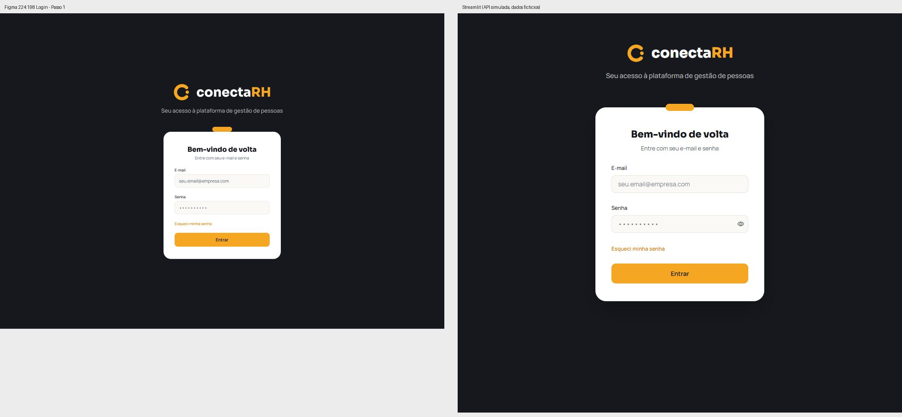 | 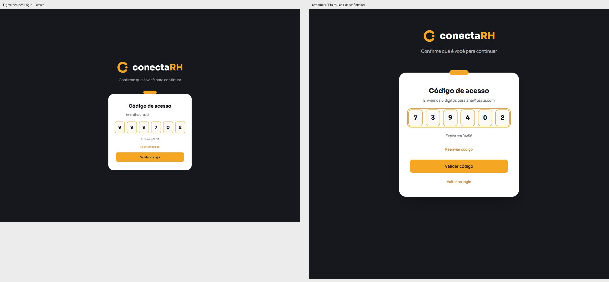 | 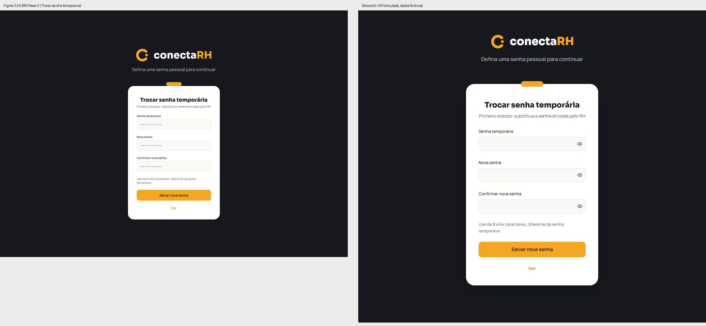 |

**Sem login**, a tela Entrar já dá acesso ao **Aviso de privacidade** e ao **Canal de denúncias**. Também ali fica o **"Esqueci minha senha"**: um código chega por e-mail para criar uma senha nova.

**Erros comuns:**
- **Senha errada 5 vezes:** a conta fica bloqueada por 15 minutos. O Admin pode desbloquear antes.
- **Código errado 5 vezes:** é preciso começar o login de novo.
- **Sessão expirada:** depois de 1 hora, o sistema pede para entrar de novo.

### Contas de demonstração

O sistema publicado tem **uma conta de demonstração para cada perfil** (Admin, RH, Gestor e Colaborador), com dados fictícios. Como o código de acesso chega por e-mail, essas contas só entram com acesso à caixa de entrada delas. Por isso, e porque o repositório é público, **e-mails e senhas não ficam neste README**.

Para avaliar o sistema com a sua própria conta:

1. Peça o acesso a um integrante do grupo, informando o seu e-mail e o perfil que quer testar.
2. O grupo cria uma ficha fictícia em **RH → Colaboradores** e a conta em **Admin → Usuários e perfis → Novo usuário**, com o seu e-mail. O e-mail de boas-vindas chega com a senha temporária.
3. Entre pelo passo a passo acima: o código chega no **seu** e-mail.

Para conhecer as telas sem login, veja os [prints](#telas) e o [manual de utilização](#manual-de-utilização) abaixo.

### Dados de demonstração

O sistema publicado simula uma empresa fictícia, para que nenhuma tela apareça vazia. Todos os nomes, CPFs, e-mails (`@exemplo.com.br`) e arquivos são inventados, e os arquivos levam a marca "documento fictício".

| Área | O que já está cadastrado |
|---|---|
| **Pessoas** | 31 colaboradores em 9 departamentos, com hierarquia, gestores de departamento, aniversariantes de novembro e um desligamento em setembro |
| **Equipe Comercial** | 7 liderados da conta de Gestor, com ponto de 3 a 19/11, metas, check-ins, PDI e reuniões 1:1 |
| **Para decidir** | 3 pedidos de férias, 1 correção de ponto (saída esquecida em 18/11), 2 ausências e solicitações ao RH |
| **Para conferir** | Comprovante de residência, de escolaridade e certidão de casamento enviados |
| **Pagamento e benefícios** | Holerites de setembro e outubro de 2026, informes de 2025 e 6 benefícios (VR, VT, saúde, odonto, seguro de vida e home office) |
| **Comunicação e desenvolvimento** | 6 comunicados vigentes, 6 treinamentos em vídeo, um ciclo de desempenho em andamento, reconhecimentos no mural e a pesquisa de clima do 2º semestre aberta |

---

## Perfis de usuários

São quatro perfis. **O que cada pessoa vê e decide é conferido no backend**, em toda requisição. O menu por perfil é só uma conveniência: quem tenta abrir uma tela que não é do seu perfil recebe "sem permissão".

| Perfil | Responsabilidade | Pode | Não pode |
|---|---|---|---|
| **Colaborador** | Cuidar da própria vida funcional | Marcar o ponto e pedir correção, pedir férias, registrar ausência, enviar documentos, ver holerites e benefícios, fazer treinamentos, acompanhar metas, PDI e avaliações, responder pesquisas, reconhecer colegas, fazer denúncia e pedidos LGPD | Ver dados de outras pessoas ou decidir qualquer pedido |
| **Gestor** | Acompanhar e decidir pela sua equipe | Tudo do Colaborador e mais: decidir férias, ausências e correções de ponto dos **liderados diretos**, ajustar a folha de ponto da equipe, criar metas e PDI, fazer check-in e reuniões 1:1, avaliar a equipe, delegar decisões e ver indicadores agregados do setor | Decidir pedidos de quem não é da sua equipe, decidir um pedido próprio, ver salário, conta bancária ou atestado da equipe |
| **RH** | Cuidar das pessoas e da conformidade | Admitir, editar fichas e desligar; conferir documentos; lançar holerites e informes; decidir ausências e solicitações; criar ciclos de avaliação, treinamentos, pesquisas e comunicados; responder pedidos LGPD; ponto REP-P; regras trabalhistas; rotina diária e anonimização | Mexer na estrutura da empresa (departamentos, cargos, níveis), nos usuários e perfis e na auditoria, que são do Admin |
| **Admin** | Cuidar do sistema | Tudo do RH e mais: criar contas e trocar perfis (com motivo), desbloquear e encerrar sessões, manter departamentos, cargos, níveis e feriados, ver a auditoria, os indicadores gerais e as integrações | Decidir um pedido próprio. Ninguém aprova um pedido seu, nem o Admin |

**Superior direto:** quem é superior direto de alguém decide os pedidos dessa pessoa como um gestor, mesmo com o perfil Colaborador. Se a pessoa não tem superior, decide o gestor do departamento. RH e Admin decidem de qualquer pessoa.

---

## Funcionalidades

### 👤 Para todas as pessoas

| Área | O que faz |
|---|---|
| **Entrada segura** | Senha e código de 6 dígitos por e-mail, troca de senha no primeiro acesso, "esqueci minha senha", bloqueio por tentativas e sessão de 1 hora |
| **Início** | Pendências, banco de horas, comunicados, aniversariantes e atalhos; sino de notificações |
| **Ponto (REP-P)** | Marcação com comprovante em PDF, espelho mensal, saldo diário com tolerância de 10 minutos, aviso de descanso de 11h e pedido de correção pela própria marcação |
| **Férias pela CLT** | Saldo do período aquisitivo, até 3 períodos, venda de até 10 dias, regras do art. 134 conferidas antes de enviar e calendário da equipe |
| **Documentos** | Anexo em PDF ou foto (até 10 MB) com os campos de cada tipo de documento, conferido pelo RH |
| **Pagamento e benefícios** | Holerites e informes de rendimentos; benefícios com operadora, links e materiais |
| **Trajetória** | Plano de carreira, avaliação 360, metas, PDI, reuniões 1:1, ciclo anual de metas e mural de reconhecimentos |
| **Meus treinamentos** | Cards por tipo (vídeo do YouTube, PDF ou apresentação), com conclusão pelo mínimo assistido ou pela leitura confirmada |
| **Clima e bem-estar** | Pesquisa de clima anônima e termômetro de humor |
| **Canal de denúncias** | Anônimo ou identificado (Lei 14.457/2022), acompanhado por código, até sem login |
| **Privacidade** | Exportar os próprios dados, fazer pedido LGPD e escolher o que os colegas veem |
| **Organograma, comunicados e FAQ** | Navegação pela hierarquia, comunicados vigentes e perguntas frequentes |

### 🧭 Gestor

O gestor decide e acompanha só os **liderados diretos**: quem tem ele como superior.

- **Central de Pendências:** decide férias (com a conferência de conflitos), ausências e correções de ponto.
- **Minha equipe e folha de ponto da equipe:** ponto da semana, férias e pendências, com ajuste direto auditado.
- **Metas e PDI da equipe:** nova meta, check-in em nome do líder, ações de PDI e reuniões 1:1 com data, hora e pauta, marcadas depois como realizadas ou canceladas.
- **Avaliações da equipe:** avaliações do ciclo e contestações.
- **Delegações:** passa a decisão de férias, correções ou tudo a outra pessoa, por um período.
- **Indicadores e termômetro de humor da equipe:** sempre agregados, sem pessoas.

### 🗂️ RH

- **Pessoas:** colaboradores (admissão, ficha, histórico e onboarding), solicitações ao RH e desligamentos.
- **Rotina:** ausências, conferência de documentos, lançamento de holerites e informes, e folha de ponto com exportação.
- **Desenvolvimento:** ciclos de avaliação, treinamentos (matriz por setor, catálogo com capa e conteúdo, registro de turma e vencimentos) e pesquisas de clima.
- **Saúde e conformidade:**
  - riscos psicossociais (NR-1);
  - pedidos LGPD com prazo;
  - ponto eletrônico REP-P (AFD e AEJ);
  - regras trabalhistas com simulação e aprovação.
- **Operação:** rotina diária, retenção e anonimização, comunicados e FAQ.

### ⚙️ Admin

- **Usuários e perfis:** criar contas, trocar perfil (com motivo), desbloquear, reenviar acesso e vincular à ficha.
- **Sessões ativas:** ver e encerrar as sessões de todas as contas.
- **Estrutura da empresa:** departamentos e gestores, feriados (com importação dos nacionais), níveis hierárquicos e cargos.
- **Auditoria:** quem fez o quê e quando, com filtros.
- **Indicadores gerais e integrações:** headcount, turnover, absenteísmo, eNPS e fila de e-mails.

---

## Manual de utilização

Passo a passo das jornadas principais, organizado por perfil. Cada passo diz **o que fazer** e **o que deve acontecer**. O [manual completo no site](https://leonardo-sferreira.github.io/conectahr/usuario.html) traz todas as telas, as regras explicadas e as perguntas frequentes.

### Como as jornadas se complementam

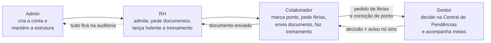

Um exemplo do ciclo completo: o **Admin** cria a conta, o **RH** admite a pessoa e pede os documentos, o **Colaborador** envia o documento e pede férias, o **Gestor** aprova as férias e o **RH** confere o documento. Cada pessoa recebe o aviso no sino, e cada passo fica na auditoria.

Em toda tela, o **menu lateral** mostra em cima as telas de todos e, abaixo, os grupos **Equipe**, **RH** e **Admin**, conforme o perfil. O **sino** no topo mostra os avisos, e o seu nome abre o menu da conta: **Configurações**, **tema claro ou escuro** e **Sair**.

### Jornada 1 · Colaborador

| # | O que fazer | O que deve acontecer |
|---|---|---|
| 1 | Entrar e ver o **Início** | Aparecem as pendências, o saldo do banco de horas, os comunicados do RH, os aniversariantes do mês e os atalhos |
| 2 | **Ponto → Hoje → Marcar ponto** e confirmar em **Confirmar e marcar** | A marcação aparece na linha do dia com o horário do servidor, e o **comprovante em PDF** fica disponível para baixar |
| 3 | **Ponto → Mês**, clicar na célula de uma marcação e enviar o pedido de correção com o motivo | O pedido vai para o superior direto, e o dia mostra a correção como pendente |
| 4 | **Férias → Solicitar férias**: escolher até 3 períodos (e, se quiser, vender até 10 dias) e **Enviar para o gestor** | A tela confere as regras da CLT antes de enviar. O pedido aparece no histórico como **Pendente**, e o gestor é avisado |
| 5 | **Documentos → Enviar →** num documento pedido: escolher o tipo, preencher os campos e anexar PDF ou foto (até 10 MB) | O documento fica **Em análise** até o RH conferir. Se for recusado, o motivo aparece na mesma tela |
| 6 | **Pagamento** e **Benefícios** | Os holerites do ano e os informes de rendimentos com **Baixar**; os benefícios ativos com a operadora, os links e os totais do mês |
| 7 | **Meus treinamentos**: abrir um card e assistir ao vídeo (ou ler o PDF) e clicar em **Concluir treinamento** | O card passa para **Concluídos**. Vídeo só conclui depois do mínimo assistido, sem contar trecho pulado |
| 8 | **Trajetória**: registrar um **check-in** numa meta, responder a avaliação e abrir o **Mural de reconhecimentos →** | O progresso da meta é atualizado; a avaliação é enviada; o reconhecimento aparece no mural para a pessoa reconhecida |

<table>
<tr>
<td width="50%">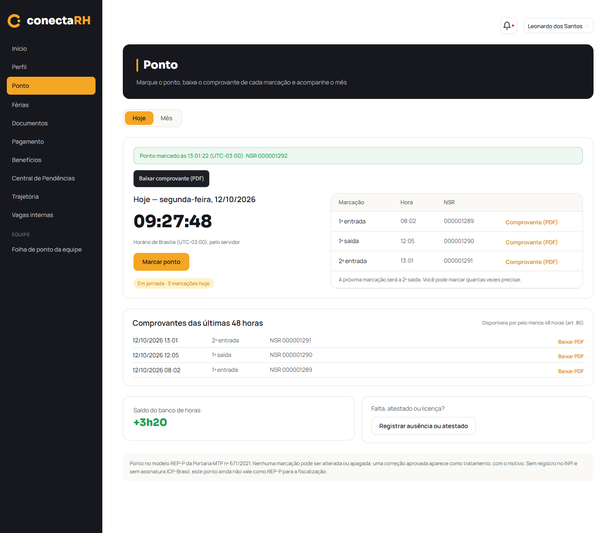<br><sub><b>Passo 2:</b> marcação feita, com comprovante</sub></td>
<td width="50%">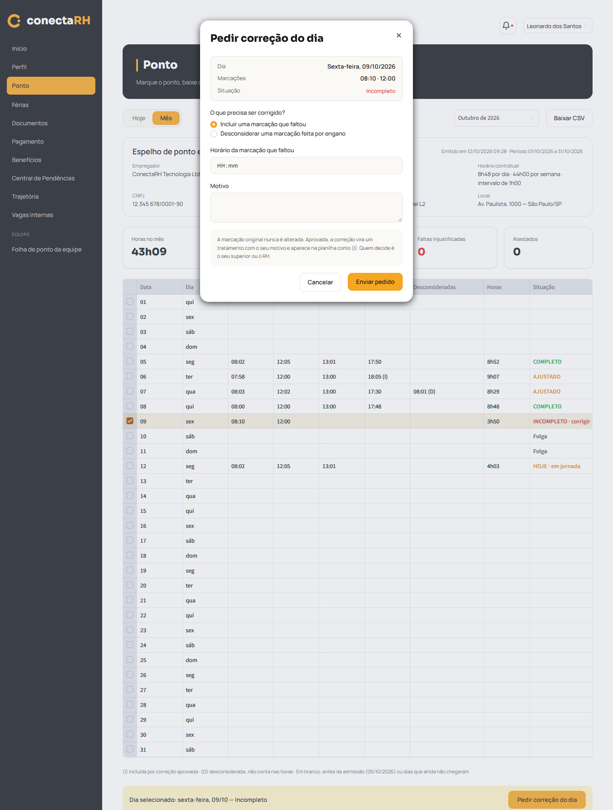<br><sub><b>Passo 3:</b> pedido de correção pela célula do mês</sub></td>
</tr>
<tr>
<td>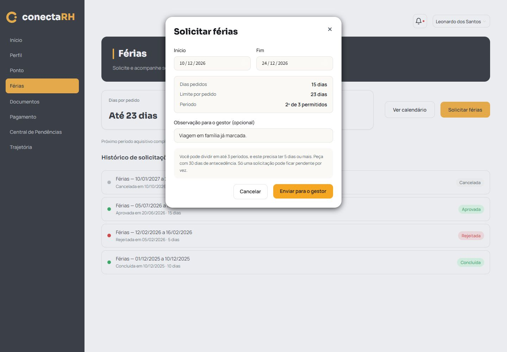<br><sub><b>Passo 4:</b> pedido de férias com a conferência da CLT</sub></td>
<td>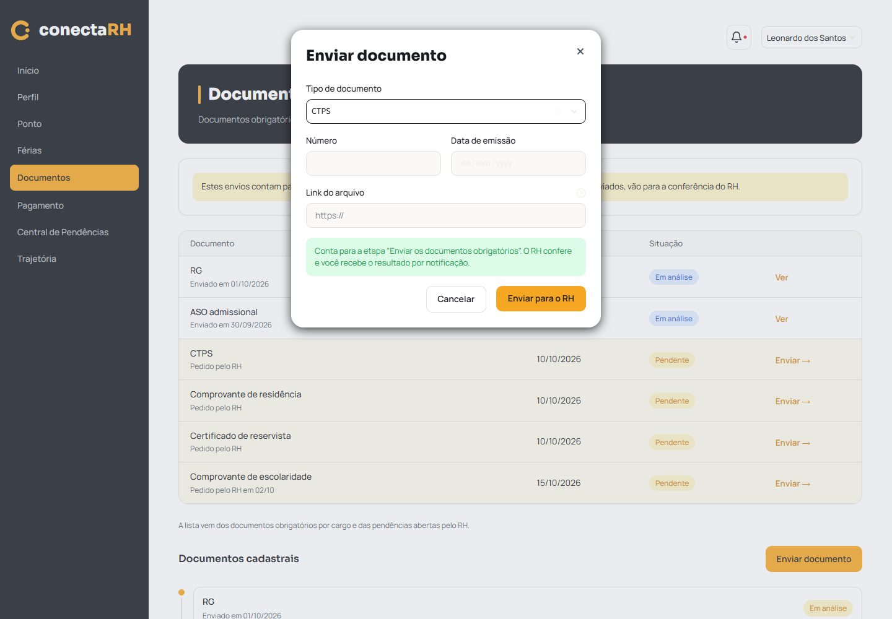<br><sub><b>Passo 5:</b> envio de documento com os campos do tipo</sub></td>
</tr>
<tr>
<td>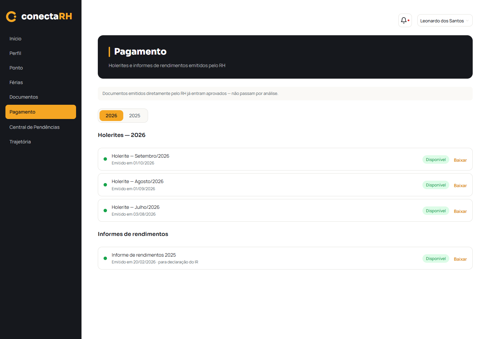<br><sub><b>Passo 6:</b> holerites e informes</sub></td>
<td>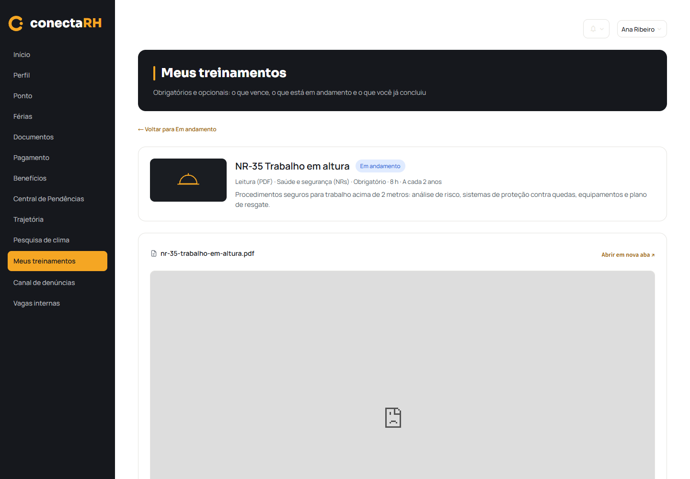<br><sub><b>Passo 7:</b> treinamento em PDF com a leitura confirmada</sub></td>
</tr>
</table>

### Jornada 2 · Gestor

O gestor tem tudo do colaborador e, no grupo **Equipe** do menu, as telas dos **liderados diretos**: as pessoas que têm ele como superior.

| # | O que fazer | O que deve acontecer |
|---|---|---|
| 1 | **Central de Pendências → Férias → Decidir →** | Abre a conferência de conflitos (antecedência, período aquisitivo, sobreposição e colegas de férias), que só informa e não bloqueia |
| 2 | **Aprovar** ou **Rejeitar** (a recusa pede justificativa) | O pedido sai da fila, o colaborador é avisado no sino, e as férias aprovadas entram no calendário da equipe |
| 3 | **Central de Pendências → Correções** e decidir a correção de ponto | Se aprovada, a marcação incluída aparece no espelho do colaborador como **(I)**. A original nunca é apagada |
| 4 | **Minha equipe** | O ponto da semana, as férias e as pendências de cada liderado. É só consulta |
| 5 | **Metas da equipe → Nova meta**, depois **Check-in** e **Agendar reunião 1:1** | A pessoa recebe a meta e a reunião no sino e por e-mail, e vê tudo na Trajetória, com quem registrou o check-in |
| 6 | **Avaliações da equipe** | Avaliar os liderados no ciclo aberto e responder às contestações antes da palavra final do RH |
| 7 | **Delegações** e **Indicadores da equipe** | Passar as decisões a outra pessoa por um período; ver os números do setor, sempre agregados e sem nomes |

> Ninguém decide um pedido próprio: se o gestor tentar, o sistema recusa e registra a tentativa na auditoria.

<table>
<tr>
<td width="50%">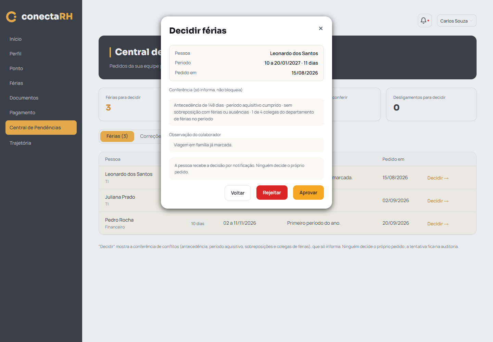<br><sub><b>Passos 1 e 2:</b> decidir férias com a conferência de conflitos</sub></td>
<td width="50%">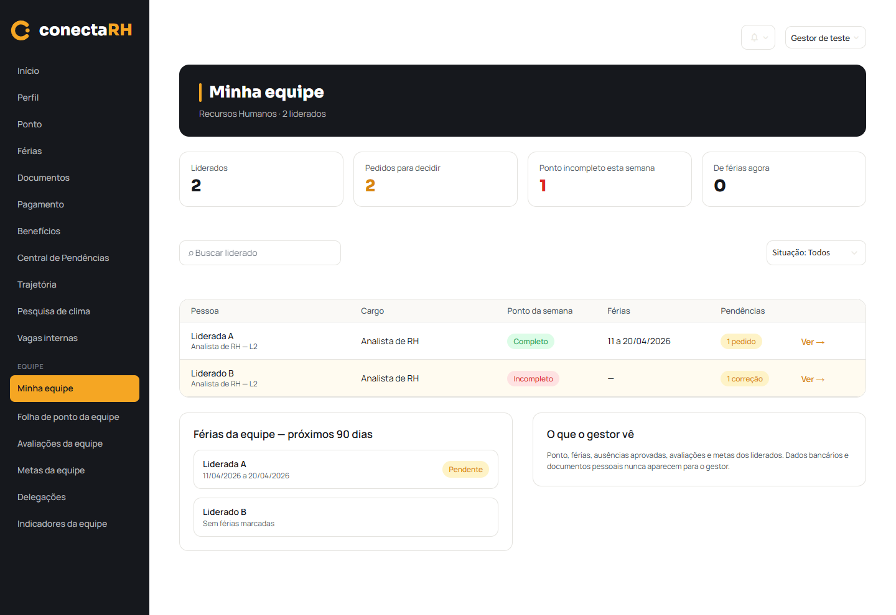<br><sub><b>Passo 4:</b> Minha equipe</sub></td>
</tr>
<tr>
<td>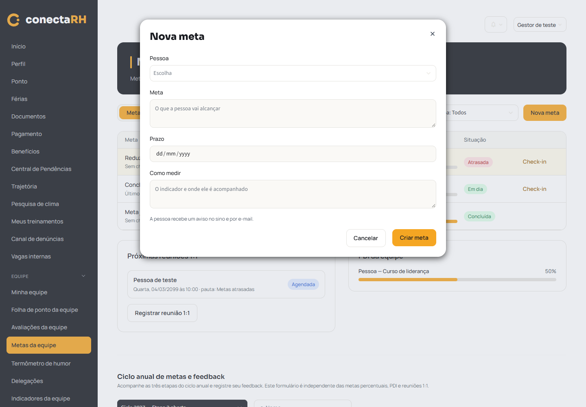<br><sub><b>Passo 5:</b> nova meta para um liderado</sub></td>
<td>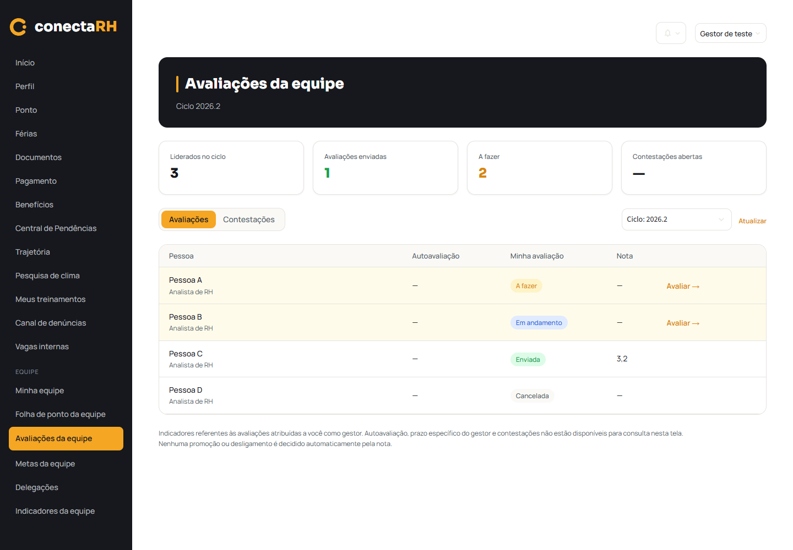<br><sub><b>Passo 6:</b> avaliações da equipe</sub></td>
</tr>
</table>

### Jornada 3 · RH

| # | O que fazer | O que deve acontecer |
|---|---|---|
| 1 | **Colaboradores → Admitir colaborador**: dados pessoais, cargo, departamento, superior direto, contrato e salário | A ficha é criada, e os **documentos obrigatórios** do tipo de contrato viram pendências para a pessoa |
| 2 | Na ficha, **Criar acesso** | A conta é criada com senha temporária, enviada por e-mail. No primeiro acesso, a pessoa cria a senha definitiva |
| 3 | **Conferência de documentos**: abrir o arquivo ao lado dos dados e **Aprovar documento** ou **Recusar documento** (com motivo) | O documento muda de situação na tela do colaborador, que é avisado. Cada abertura do arquivo fica na auditoria |
| 4 | **Lançamento de pagamentos → Lançar holerite** (mês, ano e arquivo PDF) | O holerite aparece em **Pagamento** para o colaborador, e a lista mostra quem já tem e quem falta |
| 5 | **Ausências**: aprovar, rejeitar ou **Registrar ausência** | A ausência entra na folha de ponto e nos indicadores. O gestor nunca vê o atestado nem o motivo médico |
| 6 | **Treinamentos → Novo treinamento** (vídeo do YouTube, PDF ou apresentação, com capa e público) | O card aparece em **Meus treinamentos** para o público escolhido, que é avisado. A **matriz** mostra quem fez o quê |
| 7 | **Comunicados e FAQ** e **Pesquisas de clima** | O comunicado aparece no Início de quem é o público, no período escolhido. A pesquisa abre para todos, com resultados só agregados |
| 8 | **Rotina diária** | Aplica o que depende da data (desligamentos agendados, vencimentos e limpezas) e mostra quanto foi aplicado |

<table>
<tr>
<td width="50%">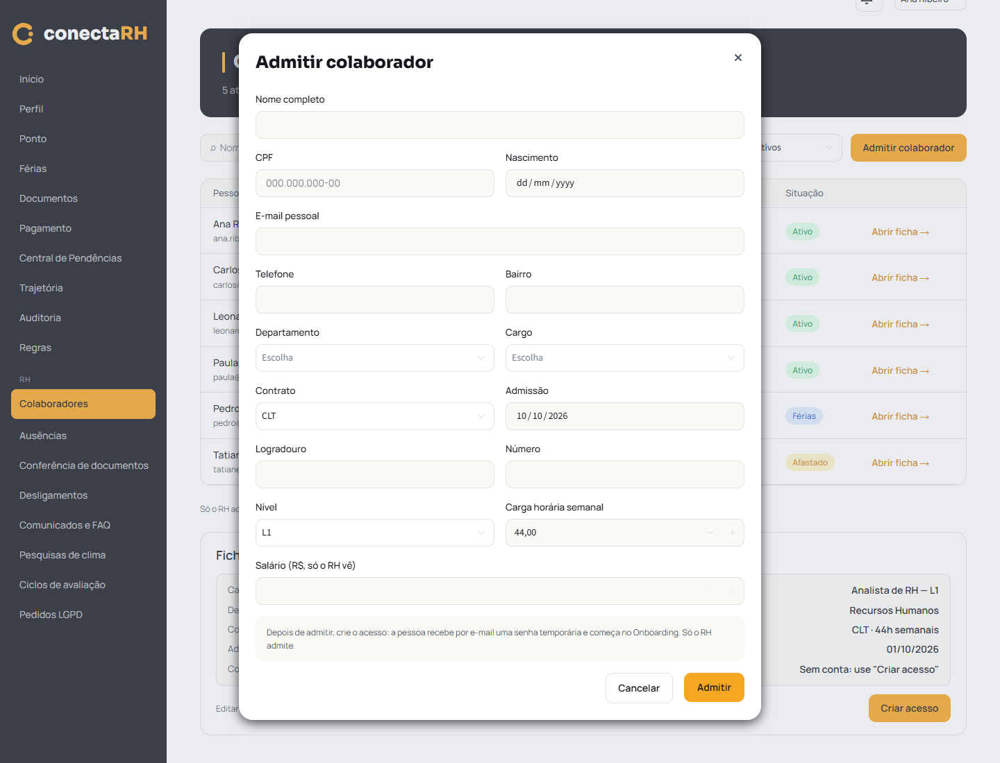<br><sub><b>Passo 1:</b> admissão</sub></td>
<td width="50%">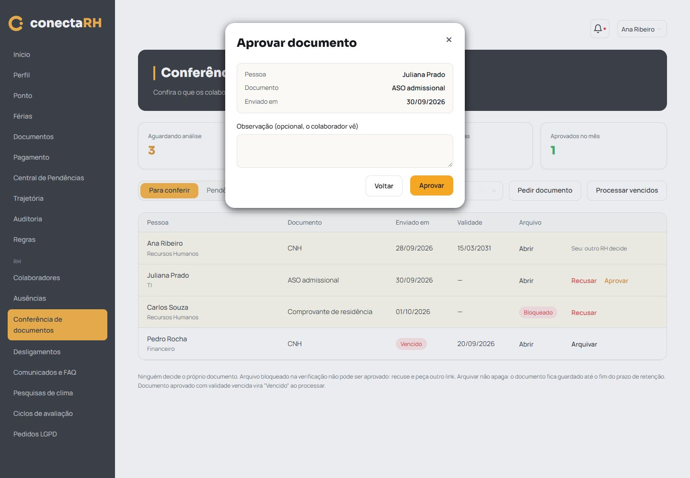<br><sub><b>Passo 3:</b> conferência de documentos</sub></td>
</tr>
<tr>
<td>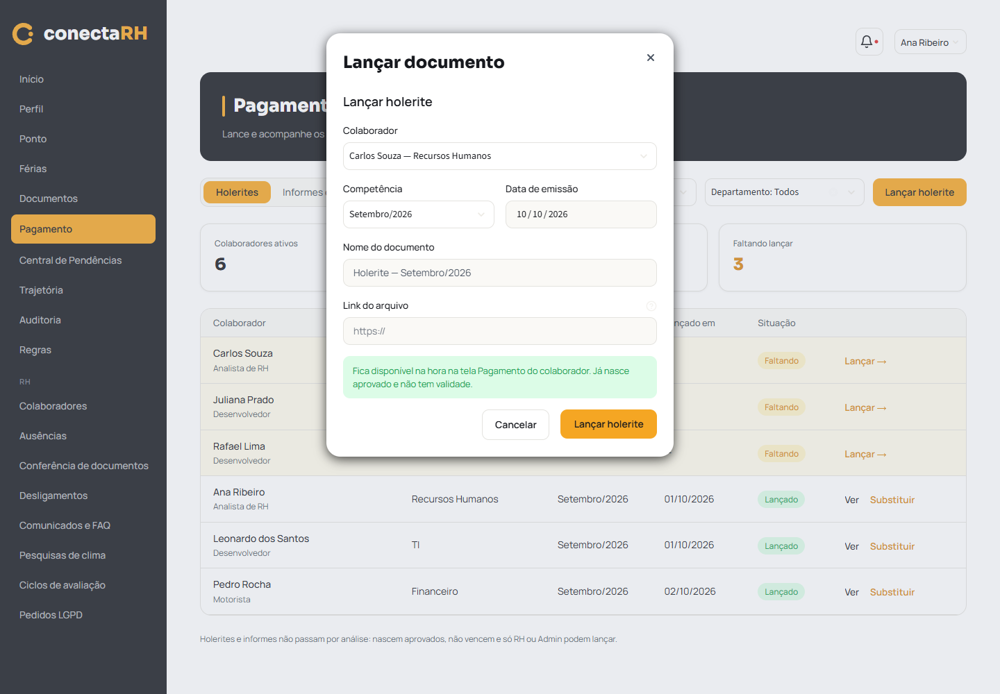<br><sub><b>Passo 4:</b> lançar holerite</sub></td>
<td>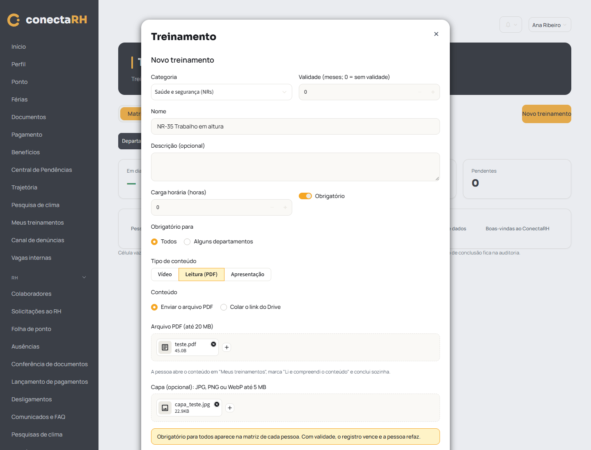<br><sub><b>Passo 6:</b> novo treinamento</sub></td>
</tr>
</table>

### Jornada 4 · Admin

O Admin tem tudo do RH e, no grupo **Admin** do menu:

| # | O que fazer | O que deve acontecer |
|---|---|---|
| 1 | **Usuários e perfis → Novo usuário**, vinculando à ficha | A conta é criada e a pessoa recebe a senha temporária por e-mail |
| 2 | **Trocar perfil** (com motivo), **Desbloquear** ou **Desativar** | A mudança vale na próxima requisição da pessoa e fica na auditoria com o motivo |
| 3 | **Estrutura da empresa**: departamentos e gestores, feriados (com a importação dos nacionais), níveis e cargos | Os departamentos e o organograma passam a refletir a estrutura; os feriados entram no ponto e no calendário de férias |
| 4 | **Auditoria**, com filtros por recurso, ação, resultado e pessoa | Cada ação aparece com autor, data, recurso e resultado, com dados pessoais mascarados |
| 5 | **Sessões ativas**, **Indicadores gerais** e **Integrações e e-mails** | Encerrar a sessão de alguém na hora; ver headcount, turnover, absenteísmo e eNPS; acompanhar a fila de e-mails |

<table>
<tr>
<td width="50%">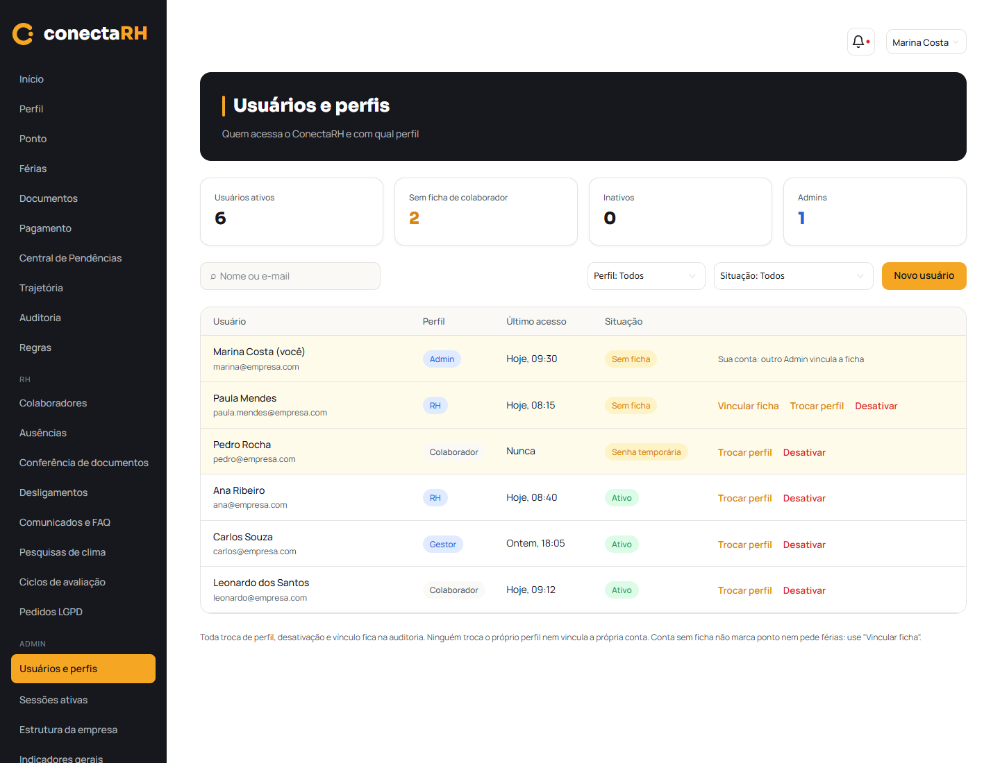<br><sub><b>Passos 1 e 2:</b> usuários e perfis</sub></td>
<td width="50%">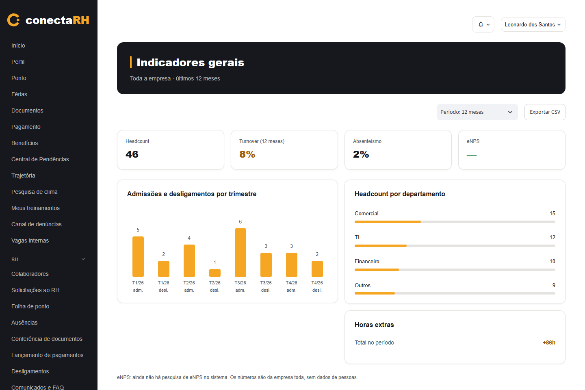<br><sub><b>Passo 5:</b> indicadores gerais</sub></td>
</tr>
</table>

### Caminhos alternativos

| Situação | Como o sistema reage |
|---|---|
| Pedido de férias fora das regras da CLT (período curto, início em dia proibido) | A tela mostra qual regra não foi atendida e não envia |
| Esqueceu de marcar a saída | O dia fica **incompleto** e vira pendência até a correção ser pedida |
| Documento recusado pelo RH | O motivo aparece em Documentos, e a pessoa envia de novo |
| Pessoa tenta abrir uma tela de outro perfil | Mensagem de "sem permissão"; o backend recusa a requisição |
| Denúncia sem se identificar | **Canal de denúncias** pela tela Entrar, sem login; o código gerado é a única forma de acompanhar |
| Quer os próprios dados (LGPD) | **Configurações → Privacidade → Baixar meus dados**, ou fazer um pedido, respondido em até 15 dias |

---

## Telas

<table>
<tr>
<td width="50%">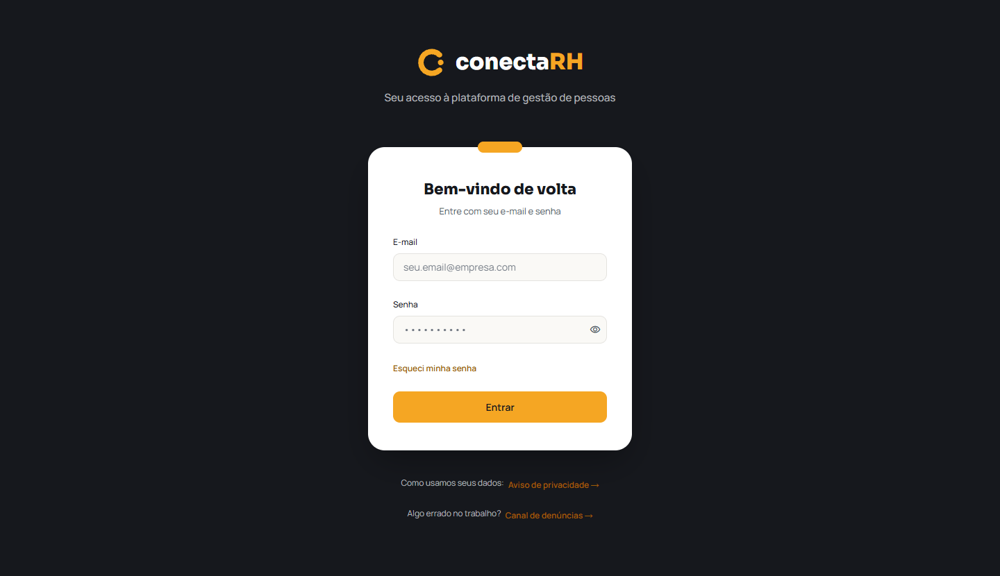<br><sub><b>Entrar</b>: senha e código por e-mail (app publicado)</sub></td>
<td width="50%"><br><sub><b>Início</b>: pendências, banco de horas, comunicados e aniversariantes</sub></td>
</tr>
<tr>
<td>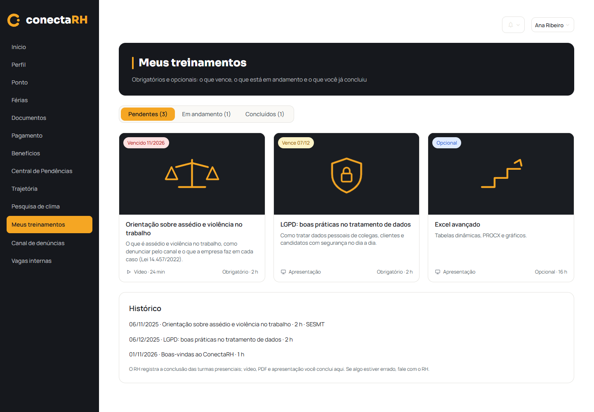<br><sub><b>Meus treinamentos</b>: cards por tipo, com filtros e capa</sub></td>
<td>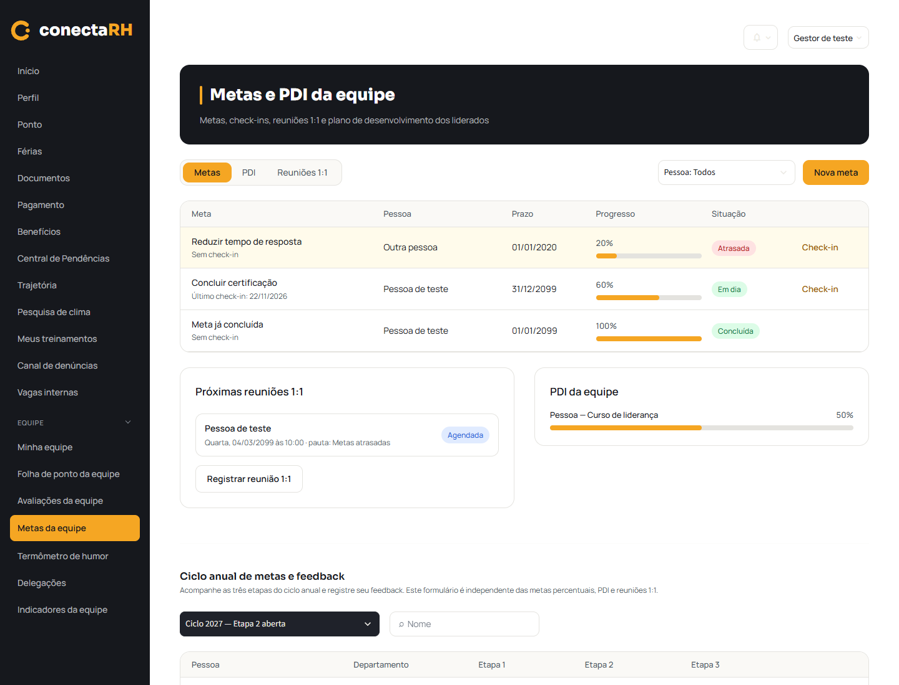<br><sub><b>Metas e PDI da equipe</b>: metas, check-in, PDI e reuniões 1:1</sub></td>
</tr>
<tr>
<td><br><sub><b>Ponto</b>: marcação no modelo REP-P, com comprovante</sub></td>
<td>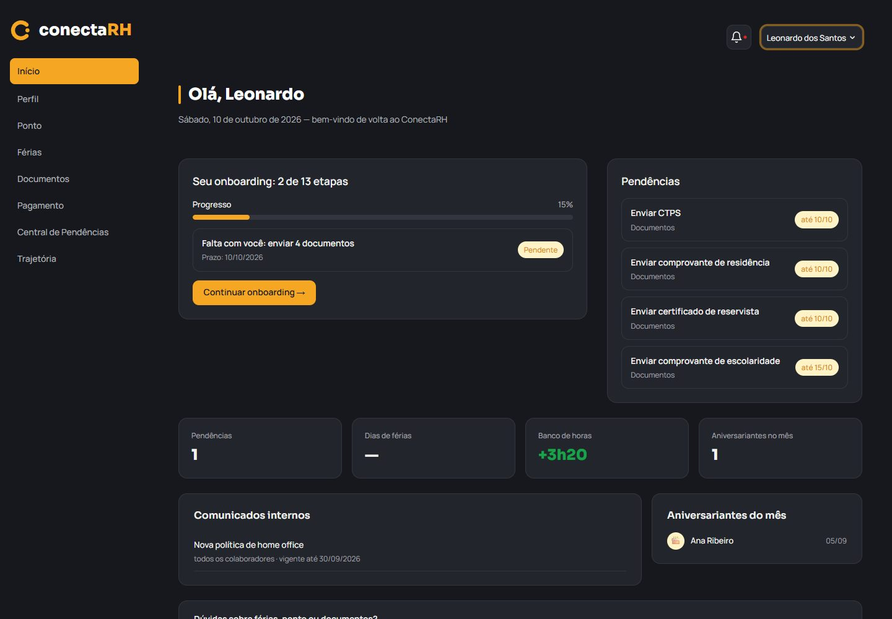<br><sub><b>Tema escuro</b>, escolhido no menu da conta</sub></td>
</tr>
</table>

Todas as telas foram desenhadas antes no [Figma](https://www.figma.com/design/fph1M5tB4rA4gqfIysSmkn), nos temas claro e escuro, e funcionam no celular (390 px) sem rolagem lateral. Os prints usam dados fictícios.

---

## Arquitetura


- **O backend decide tudo:** regras de negócio, autorização por perfil e escopo, e persistência. O frontend nunca é mecanismo de segurança; o menu por perfil é só conveniência.
- **Guarda em cada endpoint:** usuário ativo, senha definitiva e sessão válida, conferidas antes de qualquer outra coisa. Um verificador no CI confere os 308 endpoints autenticados a cada Pull Request.
- **Arquivos fora do Xano:** o arquivo vai do Streamlit direto para um bucket privado do Supabase, por um endereço de uso único gerado pelo Xano. A chave do Supabase fica só no Xano, e a leitura é por link assinado de curta duração.
- **Só inclusão onde a lei pede:** marcações de ponto, banco de horas, check-ins e histórico profissional nunca são editados nem apagados; correção é um novo registro.

Detalhes na [documentação técnica](https://leonardo-sferreira.github.io/conectahr/tecnica.html).

### Stack

| Camada | Tecnologia | Uso |
|---|---|---|
| Frontend | [Streamlit](https://streamlit.io) 1.64 (Python 3.12) | Telas por perfil, tema próprio, fontes servidas pelo próprio app |
| Hospedagem | [Streamlit Community Cloud](https://streamlit.io/cloud) | Republica a cada merge no `master` |
| Backend | [Xano](https://xano.com) + XanoScript | API, banco relacional e regras, versionados em `xano-workspace/` |
| Arquivos | [Supabase Storage](https://supabase.com/storage) | Buckets privados de documentos, fotos de perfil e treinamentos |
| E-mail | [Brevo](https://www.brevo.com) | Código de acesso, redefinição de senha e avisos (fila com tentativas) |
| Dados públicos | [BrasilAPI](https://brasilapi.com.br) | Feriados nacionais e CEP |
| Design | [Figma](https://www.figma.com/design/fph1M5tB4rA4gqfIysSmkn) | Design system, protótipo navegável e fluxos, nos temas claro e escuro |
| Especificação | [OpenSpec](https://github.com/Fission-AI/OpenSpec) | Explorar → Propor → Revisar → Aplicar → Arquivar |
| CI e documentação | GitHub Actions + GitHub Pages | Pipeline **Validar** em todo PR e site da documentação |

---

## Regras de negócio em destaque

O mapa completo, com o arquivo de cada regra, está em [`docs/regras-de-negocio.md`](docs/regras-de-negocio.md).

| Domínio | Regras |
|---|---|
| **Acesso** | Ninguém decide um pedido seu; o gestor só vê os liderados (superior direto ou departamento); estrutura da empresa e auditoria só do Admin |
| **Ponto (REP-P)** | NSR sequencial e hash SHA-256 encadeado; dia civil de Brasília; jornada aberta vira "incompleto"; tolerância de 10 min (CLT art. 58 §1º); descanso de 11h avisado |
| **Férias** | Saldo do período aquisitivo; até 3 períodos, um de pelo menos 14 dias; venda de até 10 dias; início fora dos dias proibidos pelo art. 134 da CLT |
| **Documentos** | Campos próprios de cada tipo, validados no backend; arquivo em bucket privado; abertura só pelo dono, o RH e o Admin, sempre auditada |
| **Desenvolvimento** | Avaliação 360 com contestação; ciclo anual de metas em três etapas; o gestor cria metas e faz check-in só nos liderados diretos |
| **Treinamentos** | Vídeo do YouTube conclui pelo mínimo assistido, sem contar trecho pulado; PDF e apresentação concluem depois de abrir e confirmar a leitura |
| **Clima e denúncias** | Resposta de clima sem identidade; resultados só agregados e com número mínimo de pessoas; denúncia tratada só pela comissão de ética |

---

## Segurança e LGPD

- **Autenticação:**
  - senha e código de acesso guardados com hash, o código com *pepper*;
  - token de 1 hora ligado a uma sessão revogável;
  - bloqueio após tentativas e alerta de acesso suspeito.
- **Autorização:** guarda replicada em cada endpoint e conferida no CI; bloqueio de autoaprovação. O atestado (dado de saúde) nunca chega ao gestor, e a conta bancária só é vista pelo titular e pelo RH.
- **Auditoria:** toda escrita grava autor, ação, recurso, registro e resultado, com o dado pessoal mascarado; toda abertura de arquivo sensível fica registrada.
- **Privacidade:**
  - exportação dos dados do titular;
  - pedido LGPD com prazo de 15 dias;
  - preferências de exibição e regras para menores de 18 anos;
  - anonimização de desligados, respeitando os prazos de guarda.
- **Sem rastreio de terceiros:** fontes servidas pelo próprio app, sem Google Fonts.
- **Repositório público sem segredos:** o pipeline procura chaves versionadas a cada PR.

Documentação em [`docs/lgpd/`](docs/lgpd/): [aviso de privacidade](docs/lgpd/aviso-de-privacidade.md),
[registro de operações](docs/lgpd/registro-de-operacoes.md), [RIPD](docs/lgpd/ripd.md),
[operadores](docs/lgpd/operadores.md), [retenção](docs/lgpd/retencao.md),
[legítimo interesse](docs/lgpd/legitimo-interesse.md) e [plano de incidentes](docs/lgpd/plano-de-incidentes.md).

---

## Qualidade e testes

O pipeline **Validar** ([`.github/workflows/validar.yml`](.github/workflows/validar.yml)) roda **52 verificações** em todo Pull Request, sem rede e sem dado real:

1. sintaxe de todo o Python;
2. **guarda de acesso** dos endpoints do Xano, inclusive a proibição de editar as tabelas do ponto;
3. fontes locais e **contraste de texto** do tema (WCAG AA, 4,5:1);
4. teste de fumaça e **as suítes de tela**, com o `AppTest` do Streamlit e uma API simulada;
5. auditoria dos seis estados de tela (carregando, vazio, sucesso, erro, bloqueado e sem permissão) em todas as páginas;
6. números da documentação em dia;
7. busca de segredos.

Além do pipeline:

- **Testes por HTTP contra o Xano real:** um caso que passa e um que falha, por perfil, com contas de teste. A última rodada (22/11/2026) teve 86 de 86 verificações: cards de treinamentos, metas e PDI da equipe, Minha equipe e estrutura da empresa só do Admin.
- **Conferência visual no Chrome:** 1440 e 390 px, temas claro e escuro, comparando com o Figma.
- **Acessibilidade:** teclado em todo o app, foco visível, textos alternativos e telas sem rolagem lateral no celular.

Os resultados ficam em [`docs/evidencias/`](docs/evidencias/), sem dado pessoal.

---

## Como rodar

> **Primeira vez no projeto?** Siga o [guia de primeiros passos](docs/primeiros-passos.md): instalar as ferramentas, rodar o sistema, rodar os testes e abrir o primeiro Pull Request.

### Frontend

```bash
python -m venv .venv
.venv\Scripts\activate                 # Linux/Mac: source .venv/bin/activate
pip install -r frontend/requirements.txt
copy .streamlit\secrets.toml.example .streamlit\secrets.toml   # Linux/Mac: cp
# informe em .streamlit/secrets.toml a URL da API do grupo de autenticação
streamlit run frontend/app.py
```

### Backend (Xano)

1. Instale a [CLI do Xano](https://docs.xano.com) e autentique um perfil (aqui, `ConectaRH`).
2. Publique `xano-workspace/` **sempre com `--dry-run` antes**:

   ```bash
   xano workspace push -p ConectaRH -i "api/conecta_rh_ponto/**/*.xs" --dry-run
   ```

3. Configure as variáveis de ambiente **no painel do Xano**, nunca no repositório:

| Variável | Para quê |
|---|---|
| `BREVO_API_KEY` | Envio de e-mail |
| `CODIGO_ACESSO_PEPPER` | Segredo do hash dos códigos de acesso |
| `SUPABASE_URL`, `SUPABASE_SERVICE_KEY` | Buckets privados de arquivos (a chave fica só no Xano) |
| `ARQUIVOS_DOMINIOS_APROVADOS` | Hosts aceitos em links de arquivo |

Opcionais e detalhes em [`docs/deploy.md`](docs/deploy.md); armadilhas do XanoScript em [`xano-workspace/AGENTS.md`](xano-workspace/AGENTS.md).

### Testes e documentação

```bash
python tools/checar_endpoints.py      # guarda de acesso do backend
python tools/testar_treinamentos.py   # qualquer suíte de tela, sem rede
python tools/gerar_site.py            # gera o site da documentação em _site/ (pip install markdown)
```

---

## Estrutura do repositório

```text
AGENTS.md            Instruções para agentes de IA (CLAUDE.md e GEMINI.md apontam para ele)
frontend/            App Streamlit: app.py, pagina_*.py (telas), *_modelo.py (regras de tela), theme.py, api_client.py
xano-workspace/      Backend em XanoScript: table/, function/, api/ (10 grupos), task/
openspec/
  specs/             Spec principal consolidada (130 requisitos)
  changes/archive/   Histórico das 40 changes entregues
docs/
  usuario/           Manual do usuário (fonte do site)
  tecnica/           Documentação técnica (fonte do site)
  regras-de-negocio.md · arquitetura.md · domain-model.md · deploy.md · monitoramento.md
  lgpd/ · ponto/     LGPD e ponto REP-P
  evidencias/        Resultados dos testes e prints (sem dado pessoal)
site/                Estilo e script do site da documentação
tools/               Verificadores, suítes de teste e o gerador do site
.github/workflows/   Pipeline Validar e publicação da documentação
```

---

## Histórico do projeto

Todo o trabalho foi especificado antes no OpenSpec. As **40 changes** abaixo estão entregues e arquivadas em [`openspec/changes/archive/`](openspec/changes/archive/).

| Período | O que foi entregue |
|---|---|
| **Setembro de 2026** | Mapeamento das regras de negócio a partir do código; backend do MVP |
| **Início de outubro** | MVP de gestão no backend, fundação do frontend, auditoria de segurança, adequação à LGPD e conclusão do MVP |
| **Meados de outubro** | Organograma e hierarquia, cadastro de cargos, campos por tipo de documento, benefícios e documentos obrigatórios por contrato |
| **Fim de outubro** | Calendário de férias da equipe, ciclo anual de metas, configurações e notificações, fluxo de desligamento, pedido de acesso, pesquisa de clima e avaliação 360, tela de regras, trajetória, foto de perfil, menu por grupos, notificações de publicação, termômetro de humor e treinamento em vídeo |
| **Novembro** | Anexo de arquivos no Supabase, avaliações e delegações da equipe, pendências do gestor, canal de denúncias, indicadores da equipe, integrações e e-mails, pedidos LGPD, riscos psicossociais (NR-1), SLA de solicitações, treinamentos obrigatórios, ponto REP-P e férias pela CLT |
| **22/11/2026** | Treinamentos em cards (vídeo, PDF e apresentação), metas, PDI e reuniões 1:1 da equipe, todas as telas restantes do frontend com acessibilidade e deploy, treinamentos só com vídeo do YouTube, e o site da documentação |

### Versões

| Versão | Marco |
|---|---|
| [v0.3.0](https://github.com/leonardo-sferreira/conectahr/releases/tag/v0.3.0) | Frontend para os quatro perfis, ponto REP-P, documentos e benefícios |
| [v0.2.0](https://github.com/leonardo-sferreira/conectahr/releases/tag/v0.2.0) | Backend, segurança, LGPD, especificações e documentação concluídos |
| [v0.1.0](https://github.com/leonardo-sferreira/conectahr/releases/tag/v0.1.0) | Backend do MVP e fundação documental do OpenSpec |

---

## Limitações conhecidas

- **Plano gratuito do Xano:**
  - 10 requisições a cada 20 segundos;
  - sem tarefas agendadas: as rotinas por data são acionadas pelo RH ou pelo Admin na "Rotina diária".
- **LGPD:** a instância do Xano fica nos EUA, uma transferência internacional a tratar.
- **Ponto:** segue o REP-P tecnicamente, mas sem registro no INPI nem certificação, então não vale para a fiscalização.

A lista completa, com o impacto e o caminho de cada uma, está na [documentação técnica](https://leonardo-sferreira.github.io/conectahr/tecnica.html).

---

## Como contribuir

1. O `master` reflete sempre o estado estável; nunca há push direto nele.
2. Uma branch por tarefa, integrada por Pull Request, com o pipeline verde e pelo menos uma revisão do grupo.
3. Mudança funcional começa por uma change no OpenSpec; tela começa pelo Figma.
4. Commits e PRs citam a tarefa do `tasks.md` da change.
5. Agentes de IA seguem o [`AGENTS.md`](AGENTS.md).

O passo a passo completo está em [`docs/primeiros-passos.md`](docs/primeiros-passos.md).

---

## Equipe

- Leonardo dos Santos
- Nicolas Risato
- Matheus

<div align="center">
<sub>ConectaRH · Trabalho acadêmico · <a href="https://leonardo-sferreira.github.io/conectahr/">Documentação</a> · <a href="https://conectahr-wtdxtqbzz4lyrpjv8a48nt.streamlit.app/">App</a></sub>
</div>
