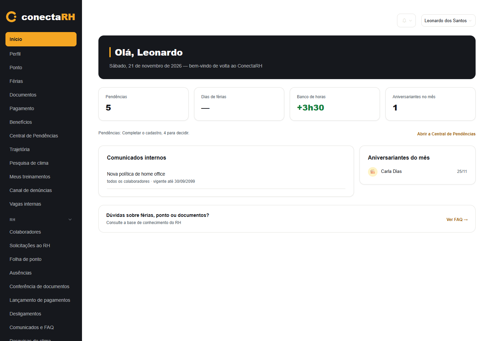
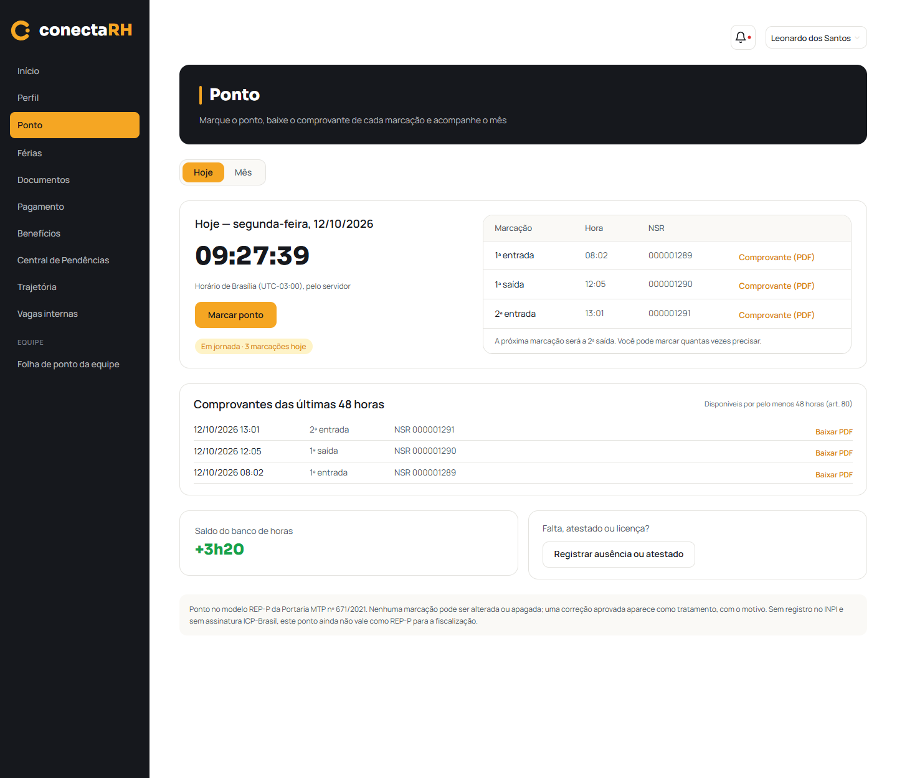
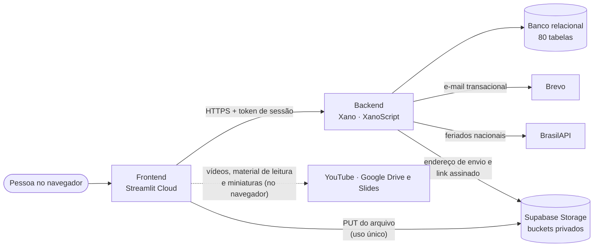

<div align="center">


# ConectaRH

**Plataforma de gestão de pessoas que centraliza o ciclo de vida do colaborador,**
**da admissão ao desligamento, com autorização por perfil, decisões auditáveis e LGPD desde o desenho.**

[](https://github.com/leonardo-sferreira/conectahr/actions/workflows/validar.yml)
[](https://leonardo-sferreira.github.io/conectahr/)


### [🚀 Abrir o app](https://conectahr-wtdxtqbzz4lyrpjv8a48nt.streamlit.app/) · [📘 Manual do usuário](https://leonardo-sferreira.github.io/conectahr/usuario.html) · [🛠️ Documentação técnica](https://leonardo-sferreira.github.io/conectahr/tecnica.html)

[Sobre](#sobre-o-projeto) · [Funcionalidades](#funcionalidades) · [Telas](#telas) · [Arquitetura](#arquitetura) ·
[Segurança e LGPD](#segurança-e-lgpd) · [Qualidade](#qualidade-e-testes) · [Como rodar](#como-rodar) · [Histórico](#histórico-do-projeto) · [Equipe](#equipe)

</div>

---

## Sobre o projeto

RH, gestores e colaboradores costumam depender de planilhas, e-mails e controles paralelos para cuidar de:
- ponto, férias e documentos;
- avaliações e treinamentos;
- desligamentos.

Isso dificulta a rastreabilidade, a auditoria e a conformidade com a legislação trabalhista e com a LGPD.

O **ConectaRH** reúne essas rotinas numa plataforma só, com quatro perfis de acesso: **Admin, RH, Gestor e Colaborador**. O que cada pessoa vê e decide depende do perfil e da hierarquia (superior direto e departamento). Toda decisão relevante fica registrada: quem fez, o quê, quando e por quê.

Um dos pilares é o **motor de regras trabalhistas**. Jornada, banco de horas e férias saem de uma matriz por tipo de contrato (CLT, estágio, aprendiz, temporário e PJ). Essa matriz pode ser sobrescrita por norma legal, instrumento coletivo ou exceção individual, sempre com o histórico de qual regra foi aplicada.

> **Trabalho acadêmico**, feito em grupo. Bases legais, prazos de guarda e regras trabalhistas são referências de estudo, a confirmar com o jurídico de quem for usar o sistema de verdade.

### Em números

<table>
<tr>
<td align="center"><b>55</b><br>telas</td>
<td align="center"><b>316</b><br>endpoints de API</td>
<td align="center"><b>80</b><br>tabelas</td>
<td align="center"><b>48</b><br>funções de regra</td>
<td align="center"><b>130</b><br>requisitos na spec</td>
<td align="center"><b>52</b><br>verificações no CI</td>
<td align="center"><b>40</b><br>changes entregues</td>
</tr>
</table>

O sistema está **publicado** no Streamlit Community Cloud, com o backend no Xano. Todas as changes planejadas foram **entregues, testadas e arquivadas** no OpenSpec. A documentação de usuário e técnica fica num [site próprio](https://leonardo-sferreira.github.io/conectahr/), que é atualizado sozinho a cada merge.

---

## Funcionalidades

### 👤 Para todas as pessoas

| Área | O que faz |
|---|---|
| **Entrada segura** | Senha e código de 6 dígitos por e-mail, troca de senha no primeiro acesso, "esqueci minha senha", bloqueio por tentativas e sessão de 1 hora |
| **Início** | Pendências, banco de horas, comunicados, aniversariantes e atalhos; sino de notificações |
| **Ponto (REP-P)** | Marcação com comprovante em PDF, espelho mensal, saldo diário com tolerância de 10 minutos, aviso de descanso de 11h e pedido de correção pela própria marcação |
| **Férias pela CLT** | Saldo do período aquisitivo, até 3 períodos, venda de até 10 dias, regras do art. 134 conferidas antes de enviar e calendário da equipe |
| **Documentos** | Anexo em PDF ou foto (até 10 MB) com os campos de cada tipo de documento, conferido pelo RH |
| **Pagamento e benefícios** | Holerites e informes de rendimentos; benefícios com operadora, links e materiais |
| **Trajetória** | Plano de carreira, avaliação 360, metas, PDI, reuniões 1:1, ciclo anual de metas e mural de reconhecimentos |
| **Meus treinamentos** | Cards por tipo (vídeo do YouTube, PDF ou apresentação), com conclusão pelo mínimo assistido ou pela leitura confirmada |
| **Clima e bem-estar** | Pesquisa de clima anônima e termômetro de humor |
| **Canal de denúncias** | Anônimo ou identificado (Lei 14.457/2022), acompanhado por código, até sem login |
| **Privacidade** | Exportar os próprios dados, fazer pedido LGPD e escolher o que os colegas veem |
| **Organograma, comunicados e FAQ** | Navegação pela hierarquia, comunicados vigentes e perguntas frequentes |

### 🧭 Gestor

O gestor decide e acompanha só os **liderados diretos**: quem tem ele como superior.

- **Central de Pendências:** decide férias (com a conferência de conflitos), ausências e correções de ponto.
- **Minha equipe e folha de ponto da equipe:** ponto da semana, férias e pendências, com ajuste direto auditado.
- **Metas e PDI da equipe:** nova meta, check-in em nome do líder, ações de PDI e reuniões 1:1 com data, hora e pauta, marcadas depois como realizadas ou canceladas.
- **Avaliações da equipe:** avaliações do ciclo e contestações.
- **Delegações:** passa a decisão de férias, correções ou tudo a outra pessoa, por um período.
- **Indicadores e termômetro de humor da equipe:** sempre agregados, sem pessoas.

### 🗂️ RH

- **Pessoas:** colaboradores (admissão, ficha, histórico e onboarding), solicitações ao RH e desligamentos.
- **Rotina:** ausências, conferência de documentos, lançamento de holerites e informes, e folha de ponto com exportação.
- **Desenvolvimento:** ciclos de avaliação, treinamentos (matriz por setor, catálogo com capa e conteúdo, registro de turma e vencimentos) e pesquisas de clima.
- **Saúde e conformidade:**
  - riscos psicossociais (NR-1);
  - pedidos LGPD com prazo;
  - ponto eletrônico REP-P (AFD e AEJ);
  - regras trabalhistas com simulação e aprovação.
- **Operação:** rotina diária, retenção e anonimização, comunicados e FAQ.

### ⚙️ Admin

- **Usuários e perfis:** criar contas, trocar perfil (com motivo), desbloquear, reenviar acesso e vincular à ficha.
- **Sessões ativas:** ver e encerrar as sessões de todas as contas.
- **Estrutura da empresa:** departamentos e gestores, feriados (com importação dos nacionais), níveis hierárquicos e cargos.
- **Auditoria:** quem fez o quê e quando, com filtros.
- **Indicadores gerais e integrações:** headcount, turnover, absenteísmo, eNPS e fila de e-mails.

---

## Telas

<table>
<tr>
<td width="50%"><br><sub><b>Entrar</b>: senha e código por e-mail (app publicado)</sub></td>
<td width="50%"><br><sub><b>Início</b>: pendências, banco de horas, comunicados e aniversariantes</sub></td>
</tr>
<tr>
<td><br><sub><b>Meus treinamentos</b>: cards por tipo, com filtros e capa</sub></td>
<td><br><sub><b>Metas e PDI da equipe</b>: metas, check-in, PDI e reuniões 1:1</sub></td>
</tr>
<tr>
<td><br><sub><b>Ponto</b>: marcação no modelo REP-P, com comprovante</sub></td>
<td><br><sub><b>Tema escuro</b>, escolhido no menu da conta</sub></td>
</tr>
</table>

Todas as telas foram desenhadas antes no [Figma](https://www.figma.com/design/fph1M5tB4rA4gqfIysSmkn), nos temas claro e escuro, e funcionam no celular (390 px) sem rolagem lateral. Os prints usam dados fictícios.

---

## Arquitetura



- **O backend decide tudo:** regras de negócio, autorização por perfil e escopo, e persistência. O frontend nunca é mecanismo de segurança; o menu por perfil é só conveniência.
- **Guarda em cada endpoint:** usuário ativo, senha definitiva e sessão válida, conferidas antes de qualquer outra coisa. Um verificador no CI confere os 308 endpoints autenticados a cada Pull Request.
- **Arquivos fora do Xano:** o arquivo vai do Streamlit direto para um bucket privado do Supabase, por um endereço de uso único gerado pelo Xano. A chave do Supabase fica só no Xano, e a leitura é por link assinado de curta duração.
- **Só inclusão onde a lei pede:** marcações de ponto, banco de horas, check-ins e histórico profissional nunca são editados nem apagados; correção é um novo registro.

Detalhes na [documentação técnica](https://leonardo-sferreira.github.io/conectahr/tecnica.html).

### Stack

| Camada | Tecnologia | Uso |
|---|---|---|
| Frontend | [Streamlit](https://streamlit.io) 1.64 (Python 3.12) | Telas por perfil, tema próprio, fontes servidas pelo próprio app |
| Hospedagem | [Streamlit Community Cloud](https://streamlit.io/cloud) | Republica a cada merge no `master` |
| Backend | [Xano](https://xano.com) + XanoScript | API, banco relacional e regras, versionados em `xano-workspace/` |
| Arquivos | [Supabase Storage](https://supabase.com/storage) | Buckets privados de documentos, fotos de perfil e treinamentos |
| E-mail | [Brevo](https://www.brevo.com) | Código de acesso, redefinição de senha e avisos (fila com tentativas) |
| Dados públicos | [BrasilAPI](https://brasilapi.com.br) | Feriados nacionais e CEP |
| Design | [Figma](https://www.figma.com/design/fph1M5tB4rA4gqfIysSmkn) | Design system, protótipo navegável e fluxos, nos temas claro e escuro |
| Especificação | [OpenSpec](https://github.com/Fission-AI/OpenSpec) | Explorar → Propor → Revisar → Aplicar → Arquivar |
| CI e documentação | GitHub Actions + GitHub Pages | Pipeline **Validar** em todo PR e site da documentação |

---

## Regras de negócio em destaque

O mapa completo, com o arquivo de cada regra, está em [`docs/regras-de-negocio.md`](docs/regras-de-negocio.md).

| Domínio | Regras |
|---|---|
| **Acesso** | Ninguém decide um pedido seu; o gestor só vê os liderados (superior direto ou departamento); estrutura da empresa e auditoria só do Admin |
| **Ponto (REP-P)** | NSR sequencial e hash SHA-256 encadeado; dia civil de Brasília; jornada aberta vira "incompleto"; tolerância de 10 min (CLT art. 58 §1º); descanso de 11h avisado |
| **Férias** | Saldo do período aquisitivo; até 3 períodos, um de pelo menos 14 dias; venda de até 10 dias; início fora dos dias proibidos pelo art. 134 da CLT |
| **Documentos** | Campos próprios de cada tipo, validados no backend; arquivo em bucket privado; abertura só pelo dono, o RH e o Admin, sempre auditada |
| **Desenvolvimento** | Avaliação 360 com contestação; ciclo anual de metas em três etapas; o gestor cria metas e faz check-in só nos liderados diretos |
| **Treinamentos** | Vídeo do YouTube conclui pelo mínimo assistido, sem contar trecho pulado; PDF e apresentação concluem depois de abrir e confirmar a leitura |
| **Clima e denúncias** | Resposta de clima sem identidade; resultados só agregados e com número mínimo de pessoas; denúncia tratada só pela comissão de ética |

---

## Segurança e LGPD

- **Autenticação:**
  - senha e código de acesso guardados com hash, o código com *pepper*;
  - token de 1 hora ligado a uma sessão revogável;
  - bloqueio após tentativas e alerta de acesso suspeito.
- **Autorização:** guarda replicada em cada endpoint e conferida no CI; bloqueio de autoaprovação. O atestado (dado de saúde) nunca chega ao gestor, e a conta bancária só é vista pelo titular e pelo RH.
- **Auditoria:** toda escrita grava autor, ação, recurso, registro e resultado, com o dado pessoal mascarado; toda abertura de arquivo sensível fica registrada.
- **Privacidade:**
  - exportação dos dados do titular;
  - pedido LGPD com prazo de 15 dias;
  - preferências de exibição e regras para menores de 18 anos;
  - anonimização de desligados, respeitando os prazos de guarda.
- **Sem rastreio de terceiros:** fontes servidas pelo próprio app, sem Google Fonts.
- **Repositório público sem segredos:** o pipeline procura chaves versionadas a cada PR.

Documentação em [`docs/lgpd/`](docs/lgpd/): [aviso de privacidade](docs/lgpd/aviso-de-privacidade.md),
[registro de operações](docs/lgpd/registro-de-operacoes.md), [RIPD](docs/lgpd/ripd.md),
[operadores](docs/lgpd/operadores.md), [retenção](docs/lgpd/retencao.md),
[legítimo interesse](docs/lgpd/legitimo-interesse.md) e [plano de incidentes](docs/lgpd/plano-de-incidentes.md).

---

## Qualidade e testes

O pipeline **Validar** ([`.github/workflows/validar.yml`](.github/workflows/validar.yml)) roda **52 verificações** em todo Pull Request, sem rede e sem dado real:

1. sintaxe de todo o Python;
2. **guarda de acesso** dos endpoints do Xano, inclusive a proibição de editar as tabelas do ponto;
3. fontes locais e **contraste de texto** do tema (WCAG AA, 4,5:1);
4. teste de fumaça e **as suítes de tela**, com o `AppTest` do Streamlit e uma API simulada;
5. auditoria dos seis estados de tela (carregando, vazio, sucesso, erro, bloqueado e sem permissão) em todas as páginas;
6. números da documentação em dia;
7. busca de segredos.

Além do pipeline:

- **Testes por HTTP contra o Xano real:** um caso que passa e um que falha, por perfil, com contas de teste. A última rodada (22/11/2026) teve 86 de 86 verificações: cards de treinamentos, metas e PDI da equipe, Minha equipe e estrutura da empresa só do Admin.
- **Conferência visual no Chrome:** 1440 e 390 px, temas claro e escuro, comparando com o Figma.
- **Acessibilidade:** teclado em todo o app, foco visível, textos alternativos e telas sem rolagem lateral no celular.

Os resultados ficam em [`docs/evidencias/`](docs/evidencias/), sem dado pessoal.

---

## Como rodar

> **Primeira vez no projeto?** Siga o [guia de primeiros passos](docs/primeiros-passos.md): instalar as ferramentas, rodar o sistema, rodar os testes e abrir o primeiro Pull Request.

### Frontend

```bash
python -m venv .venv
.venv\Scripts\activate                 # Linux/Mac: source .venv/bin/activate
pip install -r frontend/requirements.txt
copy .streamlit\secrets.toml.example .streamlit\secrets.toml   # Linux/Mac: cp
# informe em .streamlit/secrets.toml a URL da API do grupo de autenticação
streamlit run frontend/app.py
```

### Backend (Xano)

1. Instale a [CLI do Xano](https://docs.xano.com) e autentique um perfil (aqui, `ConectaRH`).
2. Publique `xano-workspace/` **sempre com `--dry-run` antes**:

   ```bash
   xano workspace push -p ConectaRH -i "api/conecta_rh_ponto/**/*.xs" --dry-run
   ```

3. Configure as variáveis de ambiente **no painel do Xano**, nunca no repositório:

| Variável | Para quê |
|---|---|
| `BREVO_API_KEY` | Envio de e-mail |
| `CODIGO_ACESSO_PEPPER` | Segredo do hash dos códigos de acesso |
| `SUPABASE_URL`, `SUPABASE_SERVICE_KEY` | Buckets privados de arquivos (a chave fica só no Xano) |
| `ARQUIVOS_DOMINIOS_APROVADOS` | Hosts aceitos em links de arquivo |

Opcionais e detalhes em [`docs/deploy.md`](docs/deploy.md); armadilhas do XanoScript em [`xano-workspace/AGENTS.md`](xano-workspace/AGENTS.md).

### Testes e documentação

```bash
python tools/checar_endpoints.py      # guarda de acesso do backend
python tools/testar_treinamentos.py   # qualquer suíte de tela, sem rede
python tools/gerar_site.py            # gera o site da documentação em _site/ (pip install markdown)
```

---

## Estrutura do repositório

```text
AGENTS.md            Instruções para agentes de IA (CLAUDE.md e GEMINI.md apontam para ele)
frontend/            App Streamlit: app.py, pagina_*.py (telas), *_modelo.py (regras de tela), theme.py, api_client.py
xano-workspace/      Backend em XanoScript: table/, function/, api/ (10 grupos), task/
openspec/
  specs/             Spec principal consolidada (130 requisitos)
  changes/archive/   Histórico das 40 changes entregues
docs/
  usuario/           Manual do usuário (fonte do site)
  tecnica/           Documentação técnica (fonte do site)
  regras-de-negocio.md · arquitetura.md · domain-model.md · deploy.md · monitoramento.md
  lgpd/ · ponto/     LGPD e ponto REP-P
  evidencias/        Resultados dos testes e prints (sem dado pessoal)
site/                Estilo e script do site da documentação
tools/               Verificadores, suítes de teste e o gerador do site
.github/workflows/   Pipeline Validar e publicação da documentação
```

---

## Histórico do projeto

Todo o trabalho foi especificado antes no OpenSpec. As **40 changes** abaixo estão entregues e arquivadas em [`openspec/changes/archive/`](openspec/changes/archive/).

| Período | O que foi entregue |
|---|---|
| **Setembro de 2026** | Mapeamento das regras de negócio a partir do código; backend do MVP |
| **Início de outubro** | MVP de gestão no backend, fundação do frontend, auditoria de segurança, adequação à LGPD e conclusão do MVP |
| **Meados de outubro** | Organograma e hierarquia, cadastro de cargos, campos por tipo de documento, benefícios e documentos obrigatórios por contrato |
| **Fim de outubro** | Calendário de férias da equipe, ciclo anual de metas, configurações e notificações, fluxo de desligamento, pedido de acesso, pesquisa de clima e avaliação 360, tela de regras, trajetória, foto de perfil, menu por grupos, notificações de publicação, termômetro de humor e treinamento em vídeo |
| **Novembro** | Anexo de arquivos no Supabase, avaliações e delegações da equipe, pendências do gestor, canal de denúncias, indicadores da equipe, integrações e e-mails, pedidos LGPD, riscos psicossociais (NR-1), SLA de solicitações, treinamentos obrigatórios, ponto REP-P e férias pela CLT |
| **22/11/2026** | Treinamentos em cards (vídeo, PDF e apresentação), metas, PDI e reuniões 1:1 da equipe, todas as telas restantes do frontend com acessibilidade e deploy, treinamentos só com vídeo do YouTube, e o site da documentação |

### Versões

| Versão | Marco |
|---|---|
| [v0.3.0](https://github.com/leonardo-sferreira/conectahr/releases/tag/v0.3.0) | Frontend para os quatro perfis, ponto REP-P, documentos e benefícios |
| [v0.2.0](https://github.com/leonardo-sferreira/conectahr/releases/tag/v0.2.0) | Backend, segurança, LGPD, especificações e documentação concluídos |
| [v0.1.0](https://github.com/leonardo-sferreira/conectahr/releases/tag/v0.1.0) | Backend do MVP e fundação documental do OpenSpec |

---

## Limitações conhecidas

- **Plano gratuito do Xano:**
  - 10 requisições a cada 20 segundos;
  - sem tarefas agendadas: as rotinas por data são acionadas pelo RH ou pelo Admin na "Rotina diária".
- **LGPD:** a instância do Xano fica nos EUA, uma transferência internacional a tratar.
- **Ponto:** segue o REP-P tecnicamente, mas sem registro no INPI nem certificação, então não vale para a fiscalização.
- **Bases legais e prazos de guarda:** são sugestões de estudo, a confirmar com o jurídico.

A lista completa, com o impacto e o caminho de cada uma, está na [documentação técnica](https://leonardo-sferreira.github.io/conectahr/tecnica.html).

---

## Como contribuir

1. O `master` reflete sempre o estado estável; nunca há push direto nele.
2. Uma branch por tarefa, integrada por Pull Request, com o pipeline verde e pelo menos uma revisão do grupo.
3. Mudança funcional começa por uma change no OpenSpec; tela começa pelo Figma.
4. Commits e PRs citam a tarefa do `tasks.md` da change.
5. Agentes de IA seguem o [`AGENTS.md`](AGENTS.md).

O passo a passo completo está em [`docs/primeiros-passos.md`](docs/primeiros-passos.md).

---

## Equipe

- Leonardo dos Santos
- Nicolas Risato
- Matheus

<div align="center">
<sub>ConectaRH · Trabalho acadêmico · <a href="https://leonardo-sferreira.github.io/conectahr/">Documentação</a> · <a href="https://conectahr-wtdxtqbzz4lyrpjv8a48nt.streamlit.app/">App</a></sub>
</div>
