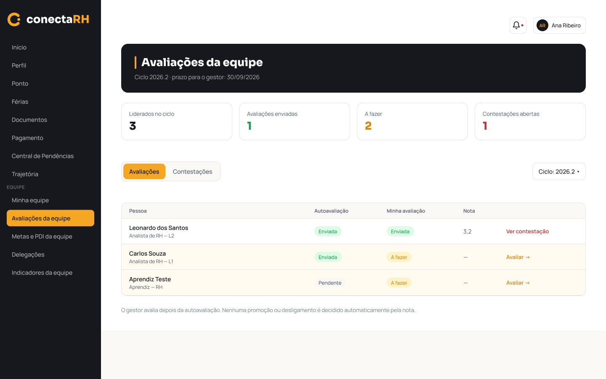
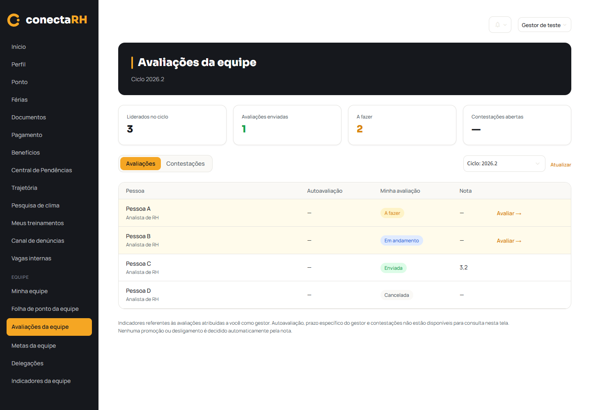
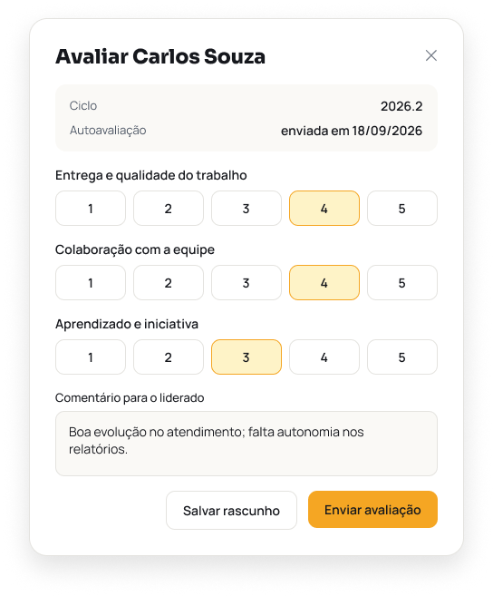
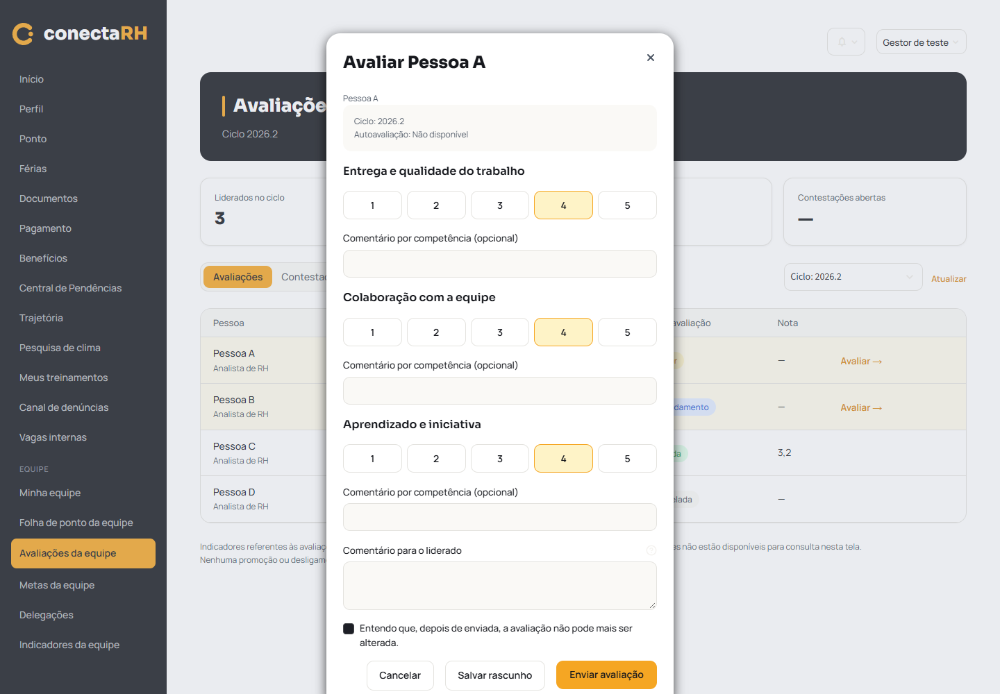

# F15 — Avaliações da equipe (implementação parcial)

Verificação local em 21/10/2026, branch `feature/modulo-gestor`. Dados inteiramente fictícios.
Nenhuma alteração ou escrita no Xano. Nenhum commit, push ou merge.

## Escopo implementado

Página `/avaliacoes-da-equipe` no menu do Gestor. Fonte: `GET minhas_avaliacoes`, filtrada por
`user_id` autenticado e `relacao_avaliador = gestor`. `GET ciclos_avaliacao` alimenta o seletor;
`GET organograma` resolve somente campos profissionais, sem ampliar autorização. Competências por
`GET avaliacoes/{id}/competencias`; antes da escrita, `GET avaliacoes/{id}` confirma a atribuição
e o estado atual. Notas/comentários por `POST .../respostas`, finalização por `POST .../enviar`.

Liderados no ciclo conta pessoas distintas nas atribuições não canceladas. Enviadas conta
`enviada`; A fazer conta `pendente` e `em_andamento`. Contestações abertas permanece `—`.
O estado da autoavaliação também é neutro; não se infere envio por ausência em filas.

## Cenários e resultados

Comando: `.venv/Scripts/python.exe tools/testar_avaliacoes_equipe.py` — **32 testes passaram**.
O cliente HTTP é substituído por API fictícia; qualquer acesso à rede real faz o teste falhar.

| Cenário | Consulta/ação simulada | Esperado e obtido |
|---|---|---|
| Gestor, avaliação própria como avaliador | `GET minhas_avaliacoes` | Só atribuições `gestor` do usuário; não confundir ID do usuário com colaborador |
| Avaliação alheia ou alvo adulterado | Formulário e `GET avaliacoes/{id}` | Sem manipulação; recusa 403, nenhuma escrita |
| Outro perfil, inclusive acesso direto | Página real | Permissão negada, sem consultar atribuições |
| Ciclos | Seletor e troca de ciclo | Lista e indicadores correspondentes; ID como identificação se metadados faltarem |
| Quatro estados | `pendente/em_andamento/enviada/cancelada` | Só os dois primeiros permitem editar; nota da enviada é exibida |
| Estado mudou em outra aba | Consulta antes da escrita | Enviada/cancelada bloqueia gravação |
| Rascunho | `POST respostas` | Notas/comentários por competência persistidos; reabertura recupera respostas; não envia comentário geral |
| Finalização | `POST respostas`, `POST enviar` | Exige todas as notas e confirmação; lista atualizada, sem nova edição |
| Falha na gravação de uma competência | Segunda resposta falha | Formulário preservado; aviso de gravação parcial; retomada grava só o que falta |
| Sem atribuições/ciclos/competências | Consultas vazias | Estado vazio ou bloqueado; nenhuma escrita indevida |
| Falha principal ou resposta malformada | `minhas_avaliacoes` | Erro, sem apresentar contagens zero falsas |
| Falha de ciclos/organograma | Consultas complementares | Atribuições permanecem acessíveis com identificação disponível |
| Sessão expirada/recusa | 401/403 | Tratamento de sessão e mensagem; sem ampliar permissões |
| Autoavaliação e contestações | Dados ausentes/área informativa | Estado neutro e nenhuma consulta proibida; nenhuma simulação de revisão |
| Dados sensíveis e HTML | Campos extras fictícios no payload | CPF/banco/documento/comentário alheio não renderizados; texto escapado |
| Sessão e cache | Troca de token/usuário e logout | Cache separado e campos do F15 descartados |
| Navegação | Início → menu Avaliações da equipe | Página funcional, sem mensagem de construção |

## Regressões e execução

| Verificação | Resultado |
|---|---|
| `tools/testar_trajetoria.py` | 44/44 |
| `tools/testar_clima_avaliacao.py` | 52/52 |
| `tools/testar_minha_equipe.py` | 31/31 |
| `tools/testar_login_f01.py` | 52/52 |
| Sintaxe dos oito arquivos Python envolvidos | Sem erro |
| `openspec.cmd validate avaliacoes-da-equipe --strict` | Válida |
| `git diff --check` | Sem erro |
| Streamlit, porta 8516, API fictícia | Iniciado e acessado pelo Chrome headless |
| `tools/testar_avaliacoes_equipe.py --navegador` | Menu, modal, rascunho, área indisponível e temas claro/escuro passaram |
| HTTP autenticado real, permitido/negado por perfil | **Não verificado**: sem sessão real disponibilizada; nenhum dado do Xano foi alterado |

## Comparação visual

Figma lido pelo MCP antes da implementação: [tela 248:744](https://www.figma.com/design/fph1M5tB4rA4gqfIysSmkn?node-id=248-744)
e [modal 248:1019](https://www.figma.com/design/fph1M5tB4rA4gqfIysSmkn?node-id=248-1019).
Comparação visual realizada com os renders e a prévia do app. Sidebar e menu da conta reutilizam
o aplicativo existente, inclusive os itens adicionais. O formulário fica mais alto pelos comentários
por competência e pela confirmação. Fontes, tokens, hero, indicadores, tabela e badges são os existentes.

| Referência Figma | Implementação com dados fictícios |
|---|---|
|  |  |
|  |  |

[Captura do tema escuro](frontend-avaliacoes-equipe/avaliacoes-equipe-escuro.png).

## Dependências que continuam abertas

**FIGMA:** Gestor responde contestação e pode manter/revisar nota.

**BACKEND ATUAL:** somente RH/Admin revisa contestação e a revisão não altera a avaliação original.
O Gestor não consulta essa fila, não envia revisão e não altera nota localmente. Não há contrato de
decisão, nota revisada ou prazo. Também não há consulta completa e autorizada da autoavaliação dos
liderados nem prazo próprio do Gestor. O organograma não fornece o nível de carreira da pessoa;
nesse caso aparece só o cargo. Comentário geral não é persistido como rascunho.

O F15 completo não está concluído. A tarefa geral e as dependências de backend permanecem abertas.
