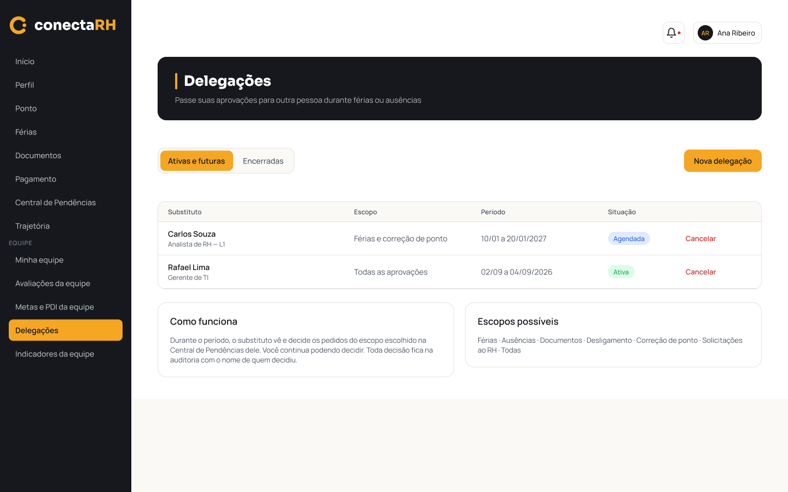
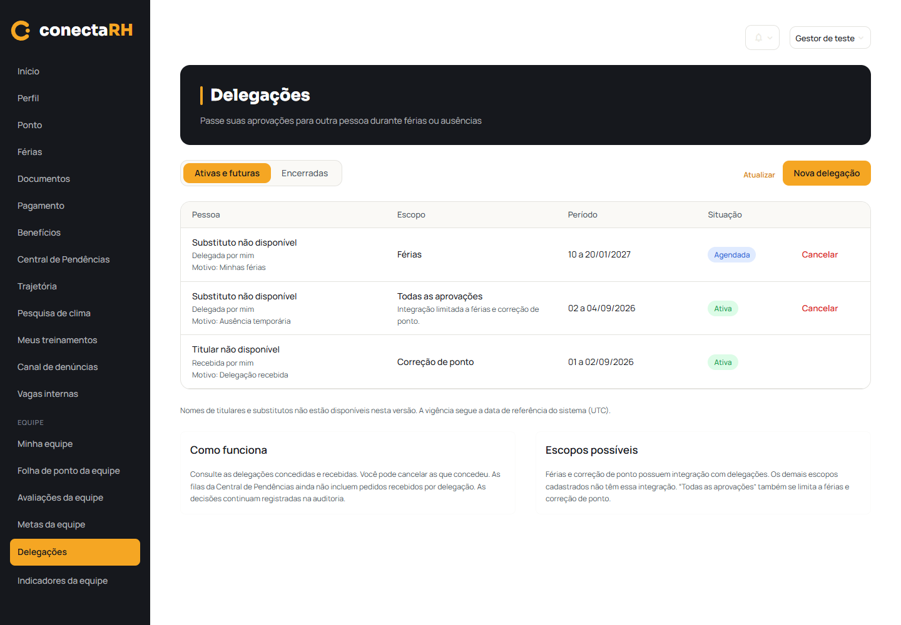
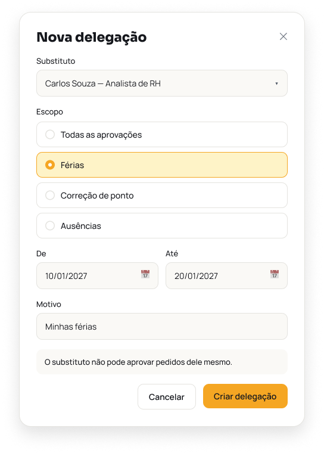
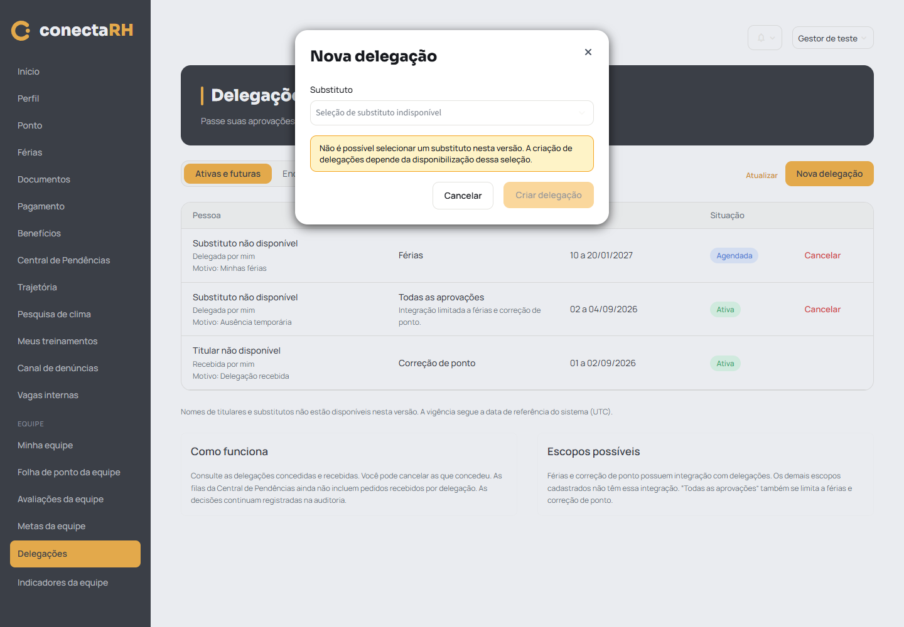

# F17 — Delegações (implementação parcial)

Verificação local em 21/10/2026, branch `feature/modulo-gestor`. Dados inteiramente fictícios.
Nenhuma escrita ou alteração no Xano. Nenhum commit, push ou merge.

## Escopo implementado

Página `/delegacoes` no menu Gestor, com `GET minhas_delegacoes` e
`POST delegacoes/{id}/cancelar`. Nenhum `POST delegacoes` nem consulta a catálogo de usuários.
Titular e substituto são comparados com `usuario.id`, nunca com `colaborador_id` ou com quem
criou o registro. A listagem descarta campos desnecessários e registros fora desse vínculo.

Ativas e futuras reúne Agendada/Ativa; Encerradas reúne Encerrada/Cancelada. O cancelamento
tem precedência sobre a vigência. Datas UTC e limites inclusivos acompanham os consumidores do
backend, sem persistir status. Dados inválidos ficam Não disponível, com aviso; não são
classificados como ativos. A página mostra período, escopo, situação, motivo e direção.

Somente o titular vê Cancelar em registro não cancelado, inclusive vencido, como o contrato
permite. Uma nova consulta confirma vínculo/estado antes do POST; a autorização final é do
backend. Só após resposta confirmada há sucesso e atualização da lista para Encerradas. Se o
GET posterior falhar, aparece sucesso da operação e erro de leitura, sem uma lista vazia falsa.

## Cenários e resultados

Comando: `.venv/Scripts/python.exe tools/testar_delegacoes.py` — **30 testes passaram**.
O cliente HTTP usa API fictícia; acesso à rede real durante esses testes faz o teste falhar.

| Cenário | Consulta/ação simulada | Esperado e obtido |
|---|---|---|
| Perfil Gestor | Página real e menu | Delegações abre sem mensagem de construção |
| Outros perfis, inclusive URL direta | Página real | Menu não ampliado; permissão negada; nenhuma consulta de delegações |
| Concedida/recebida | `GET minhas_delegacoes` | Direção correta; criador não define titularidade; IDs de usuário não confundidos com colaborador |
| Quatro estados | Datas e cancelamento | Agendada, Ativa, Encerrada, Cancelada; abas corretas; início/fim inclusivos e cancelamento prevalece |
| Virada do dia | Relógio UTC | Mesma data de referência dos consumidores do backend |
| Lista vazia | GET sem registros | Vazio nas duas abas, nenhuma escrita |
| Falha de consulta | GET 500 ou resposta malformada | Erro e recuperação, sem converter falha em vazio |
| Falha parcial | Registro com dados incompletos | Aviso, estado neutro e preservação dos demais registros |
| Recusa/sessão expirada | 403/401 | Mensagem de permissão e tratamento de sessão existente |
| Cancelamento permitido | GET atual e POST vazio com ID na rota | Confirmação, sucesso, cache invalidado e Cancelada em Encerradas |
| Cancelamento recusado | POST 403 | Erro, sem alterar situação localmente |
| Recebida, alheia ou já cancelada | Cancelamento direto no helper | Bloqueado sem POST |
| Outra sessão já cancelou | GET anterior ao POST | Estado atual impede repetir cancelamento |
| POST sem confirmação | Resposta incompleta | Não informa sucesso falso |
| Cancelou, mas GET posterior falhou | POST confirmado seguido de GET 500 | Preserva sucesso; mostra erro de leitura; retry recupera registro cancelado |
| Criação indisponível | Modal Nova delegação | Seletor e Criar delegação desabilitados; nenhum campo de ID, POST ou catálogo |
| Escopos antigos e `todas` | Listagem e cartões | Avisos de integração parcial; nenhuma promessa de filas delegadas |
| Segurança | Campos extras fictícios e HTML no motivo | CPF/banco/documento/nome não autorizado/IDs não renderizados; texto escapado |
| Cache/sessão/logout | Troca de conta/token e limpeza | Cache de 20 s separado; estado do F17 descartado; preferência de tema preservada |

Não há teste simulando encaminhamento funcional à Central; essa funcionalidade não existe
nesta entrega.

## Regressões e execução

| Verificação | Resultado |
|---|---|
| `tools/testar_decisoes.py` | 64/64 verificações |
| `tools/testar_ferias.py` | 93/93 verificações |
| `tools/testar_folha_ponto.py` | 46/46 verificações |
| `tools/testar_ponto.py` | 41/41 verificações |
| `tools/testar_ponto_mensal.py` | 97/97 verificações |
| `tools/testar_login_f01.py` | 52/52 verificações |
| `tools/testar_minha_equipe.py` | 31 testes, OK |
| `tools/testar_avaliacoes_equipe.py` | 32 testes, OK |
| Sintaxe dos sete arquivos Python envolvidos | Sem erro, compilação em memória |
| `openspec.cmd validate delegacoes-do-gestor --strict` | Válida |
| `git diff --check` | Sem erro |
| Streamlit, porta 8517, API fictícia | Iniciado e acessado pelo Chrome headless |
| `tools/testar_delegacoes.py --navegador` | Consulta, modal bloqueado, cancelamento, menu e temas claro/escuro passaram |
| HTTP autenticado real, permitido/negado por perfil | **Não verificado:** sem sessão real de teste disponibilizada; nenhuma operação no Xano |

## Comparação visual

Figma lido pelo MCP antes da implementação:
[tela 248:2235](https://www.figma.com/design/fph1M5tB4rA4gqfIysSmkn?node-id=248-2235)
e [modal 248:2465](https://www.figma.com/design/fph1M5tB4rA4gqfIysSmkn?node-id=248-2465).
Composição preserva topbar, hero, abas, tabela, badges, botão e dois cartões usando apenas os
componentes/tokens existentes. O menu inclui as demais páginas já implementadas no aplicativo.

Diferenças intencionais: Pessoa substitui Substituto no cabeçalho para incluir recebidas;
direção e motivo aparecem na mesma célula. Sem catálogo autorizado, nomes/cargos são neutros.
Cartões e escopos explicam as limitações reais. Modal mostra apenas o bloqueio do seletor e da
criação, sem oferecer campos que não poderiam ser enviados. Nota de vigência UTC e botão
Atualizar permitem conferir os dados atuais. Não há novo CSS, design system ou tela de auditoria.

| Referência Figma | Implementação com dados fictícios |
|---|---|
|  |  |
|  |  |

[Encerradas após cancelamento](frontend-delegacoes/delegacoes-encerradas.png).
[Tema escuro](frontend-delegacoes/delegacoes-escuro.png).

## Dependências que continuam abertas

**Figma:** permite criar escolhendo substituto por nome/cargo, apresenta vários escopos e
promete encaminhamento das decisões à Central do substituto (`248:2513`/`248:2519`).

**Backend atual:** criação exige `substituto_user_id`, sem catálogo autorizado ao Gestor.
Não se pede ID manual, não se consulta catálogo restrito e não se usa `colaborador_id`.
As filas da Central não incorporam delegações, e a abertura das abas segue a hierarquia normal.
Só férias e correção de ponto possuem consumidores reais, inclusive quando o escopo é `todas`.
Os demais escopos não produzem o efeito prometido. A hierarquia normal por superior direto
diverge da autorização delegada pelo gestor departamental; isso não é corrigido no frontend.

Decisões continuam auditadas pelo backend; a consulta geral é RH/Admin e não há `delegacao_id`
estruturado em todas as decisões. Nenhum histórico é simulado. `pagina_central.py`, backend,
configurações locais do MCP e permissões permanecem inalterados. O F17 completo e a tarefa
geral 55 continuam pendentes.
