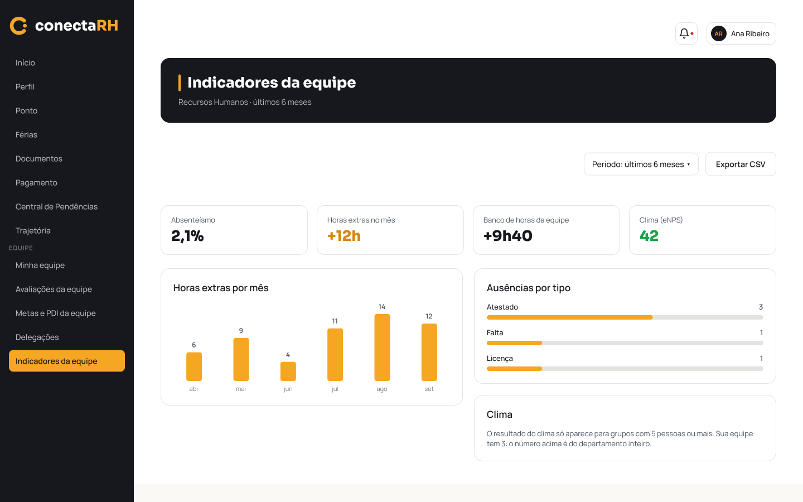
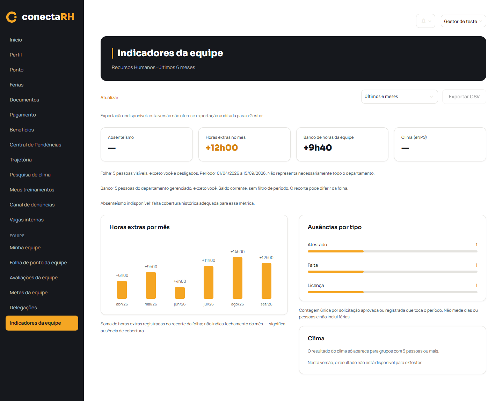

# F18 — Indicadores da equipe (implementação parcial)

Verificado localmente em 21/10/2026, branch `feature/modulo-gestor`, com dados inteiramente
fictícios. Nenhuma escrita/alteração no Xano, nenhum commit, push ou merge.

## Fontes e cobertura

| Fonte | Recorte e uso | Limite preservado |
|---|---|---|
| `GET folha_ponto/pessoas` | IDs autorizados pela folha, exceto próprio/desligados | Snapshot atual; não representa necessariamente todo o departamento nem só subordinados diretos |
| `GET folha_ponto/mes?ano=...&mes=...` | Seis meses para esse mesmo recorte: registros de ponto e ausências | Mês corrente até hoje; fonte/mês ausente não vira zero |
| `GET organograma` | Departamento cujo gestor é o colaborador autenticado e pessoas não desligadas desse departamento | Identificação precisa ser única e estrutura válida; não amplia permissão |
| `GET colaboradores/{id}/banco_horas` | Pessoas desse departamento, exceto próprio | Somente saldo corrente; nenhuma conversão em histórico de seis meses |

IDs ficam internos; não há nomes individuais, CPF, documentos, conta bancária, comentários ou
respostas de clima na página. Cache de 60 s por endpoint/sessão, com projeções mínimas e
Atualizar. A troca de conta e o logout descartam estado e dados F18.

Últimos seis meses é a única opção: corrente e cinco anteriores, do primeiro dia do primeiro
mês até hoje em Brasília. O card de horas extras usa apenas o mês corrente até hoje. A série
usa os valores `horas_extras` gravados, sem recalcular jornada e sem substituir por saldo
positivo diário. Exige pelo menos um registro válido de cada pessoa no mês; isso comprova a
cobertura dos valores registrados, não o fechamento de todos os dias da folha. Sem essa
cobertura, erro, campo ausente, valor inválido ou conflito: `—`. Zero só com registros válidos
de todos cujo total seja zero.

Ausências são **solicitações/registros**, não dias nem pessoas: a entidade possui ID e a
implementação administrativa já conta registros (`docs/indicadores.md`, função
`calcular_indicadores`). Nesta página, contam Aprovada/Registrado que tocam o período,
deduplicadas por ID entre meses; Pendente/Rejeitada, próprio, pessoas fora do recorte e férias
não entram. A unidade é informada na tela. Qualquer mês sem lista de ausências válida impede
o agregado do período; não se mostra uma soma parcial como total.

Banco soma os saldos retornados, preservando sinais e arredondando apenas na formatação do
total. Falha em uma pessoa, saldo ausente ou catálogo ambíguo deixa o total indisponível, sem
derrubar a folha. Populações e quantidades da folha e banco aparecem separadamente. O piso
padrão de cinco pessoas da spec de indicadores é aplicado a cada grupo na apresentação;
não se consulta nem altera a configuração administrativa do Xano.

## Cenários executados

`.venv/Scripts/python.exe tools/testar_indicadores_equipe.py`: **37 testes passaram**.
API fictícia substitui o cliente HTTP; qualquer requisição real nos testes faz o teste falhar.

| Cenário | Consulta/ação simulada | Esperado e obtido |
|---|---|---|
| Gestor e navegação real | Menu → `/indicadores-da-equipe` | Página funcional; sem mensagem de construção |
| Outros perfis, inclusive URL direta | Página real | Permissão negada, sem consultas F18 nem expansão do menu |
| Período | Seis consultas mensais, inclusive virada de ano | Série ordenada; corrente só até hoje |
| Horas gravadas | Soma de `horas_extras` | Valores mensais corretos; próprio/futuro/outro mês fora |
| Mês vazio | Lista vazia de registros | `—`, sem zero inventado; demais meses preservados |
| Zero confirmado | Todos com registros e valores zero | Zero legítimo |
| Cobertura/valores parciais | Falta pessoa ou valor nulo/negativo/não finito | Mês indisponível |
| Duplicidade/conflito | Registro repetido ou alterado com mesmo ID | Sem dupla soma; conflito não produz total |
| Banco positivo/negativo | Saldos individuais | Sinais preservados e total correto; exemplo fictício `+9h40` |
| Banco parcial/sem saldo | GET 403/500 ou saldo ausente | Total `—`, horas extras continuam disponíveis |
| Folha negada | GET pessoas 403 | Banco autorizado continua disponível |
| Recortes diferentes | Pessoa visível na folha em outro departamento | Não consultar seu banco por suposição; usar catálogo departamental autorizado |
| Próprio/desligado/IDs distintos | IDs de usuário e colaborador diferentes | Próprio e desligado excluídos; nunca usar user_id como colaborador_id |
| Estrutura ambígua/incompleta | Organograma ausente, duplicado ou ficha divergente | Nenhuma consulta individual de banco |
| Ficha ausente na sessão | Identificação pela linha `e_voce` | Usa colaborador confirmado da folha, nunca user_id |
| Ausências agrupadas | Mesma solicitação cruza agosto/setembro | Conta uma vez; aprovada/registrada; férias não entram |
| Ausências sem cobertura/conflitantes | Mês ausente ou mesmo ID com dados divergentes | Gráfico indisponível, sem contagem parcial |
| Ausências vazias confirmadas | Listas vazias válidas nos seis meses | Mensagem nenhuma solicitação no período |
| Payload parcial | Ausências ausentes, registros presentes | Horas permanecem disponíveis; ausências não viram vazio |
| Grupo pequeno/sem pessoas | Menos de cinco em cada recorte | Agregados suprimidos, estado explicativo |
| Absenteísmo e clima | Cards e explicações | `—`, sem fórmula inventada ou consultas restritas |
| CSV | Botão e ausência de download | Desabilitado; nenhum arquivo local ou endpoint proibido |
| Privacidade e HTML | Campos extras fictícios e nome departamental com marcação | Campos sensíveis descartados; texto escapado |
| Sessão e cache | Atualizar, trocar sessão, logout, 401 | Dados isolados/limpos e tratamento de expiração existente |
| Claro e escuro | AppTest e Chrome | Valores e indisponibilidades preservados; contraste revisado visualmente |

## Regressões e verificações

| Comando/verificação | Resultado |
|---|---|
| `tools/testar_folha_ponto.py` | 46/46 verificações |
| `tools/testar_ponto.py` | 41/41 verificações |
| `tools/testar_ponto_mensal.py` | 97/97 verificações |
| `tools/testar_clima_avaliacao.py` | 52/52 verificações |
| `tools/testar_minha_equipe.py` | 31 testes, OK |
| `tools/testar_avaliacoes_equipe.py` | 32 testes, OK |
| `tools/testar_delegacoes.py` | 30 testes, OK |
| `tools/testar_login_f01.py` | 52/52 verificações |
| Sintaxe dos oito arquivos Python envolvidos, compilação em memória | Sem erro |
| `openspec.cmd validate indicadores-da-equipe --strict` | Válida |
| `git diff --check` | Sem erro |
| Streamlit na porta 8518 com API fictícia | Iniciado e acessado pelo Chrome headless |
| `tools/testar_indicadores_equipe.py --navegador` | Consulta, navegação, seis barras, CSV indisponível e claro/escuro passaram |
| HTTP real por perfil | **Não verificado**: sem sessão de teste disponibilizada; nenhuma chamada real ao Xano |

## Comparação visual e dependências abertas

Referências conferidas pelo MCP antes de codificar:
[F18 — tela 248:2694](https://www.figma.com/design/fph1M5tB4rA4gqfIysSmkn?node-id=248-2694)
e [escuro 315:3925](https://www.figma.com/design/fph1M5tB4rA4gqfIysSmkn?node-id=315-3925).
Reutilizados hero, indicadores, cartões, barras horizontais e tokens; barras verticais
acrescentadas somente ao `theme.py`, com cores claras/escuras existentes. O aplicativo mantém
os demais itens do menu já implementados.

| Referência Figma | Aplicativo com dados fictícios |
|---|---|
|  |  |

[Captura do tema escuro](frontend-indicadores-equipe/indicadores-equipe-escuro.png).

**Figma prevê:** Absenteísmo, Horas extras, Banco de horas, Clima/eNPS e Exportar CSV.

**Backend atual permite parcialmente:** horas extras e ausências no recorte autorizado da
folha; banco corrente departamental autorizado. Não há garantia de departamento inteiro na
folha, quadro histórico do período, fórmula de absenteísmo por horas perdidas com a precisão
do desenho, contrato de clima delimitado ao Gestor ou exportação auditada do F18.

Diferenças intencionais: Absenteísmo e Clima `—`; CSV desabilitado; seletor só Últimos 6 meses;
horas formatadas com minutos/sinal e competências com ano; contagem de ausências explicitada;
notas de cobertura, saldo corrente e indisponibilidade deixam a tela mais alta. O card Clima
preserva “O resultado do clima só aparece para grupos com 5 pessoas ou mais.” e informa que
o Gestor não dispõe do resultado nesta versão, sem inventar fallback departamental.

Nenhuma consulta a indicadores globais, resultados de clima, calendário ou catálogo restrito;
nenhuma exportação local fingindo auditoria. F18 completo e tarefa geral 49 permanecem pendentes.
