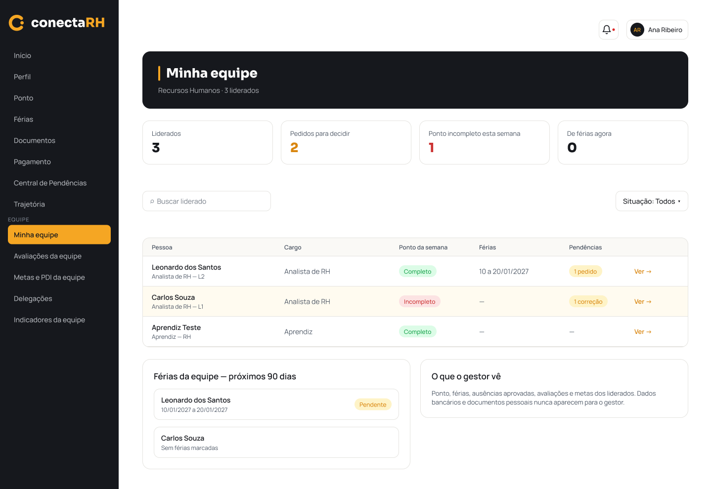
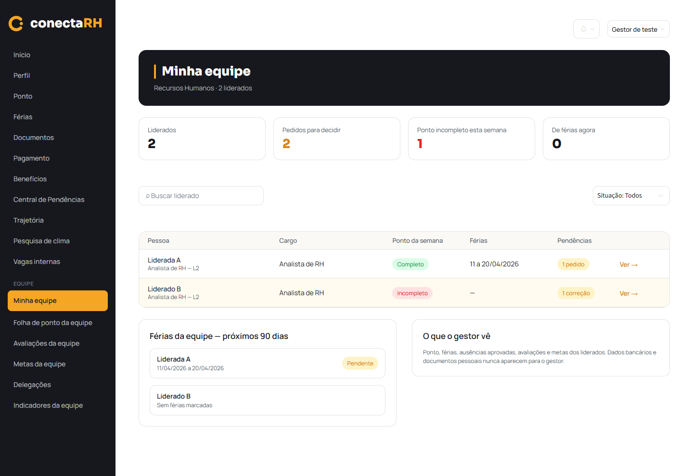

# Minha equipe — F14 (20/10/2026)

Referência: [F14, seção 248:386](https://www.figma.com/design/fph1M5tB4rA4gqfIysSmkn?node-id=248-386),
[Gestor — Minha equipe, 248:409](https://www.figma.com/design/fph1M5tB4rA4gqfIysSmkn?node-id=248-409).
O contexto e a captura foram lidos pelo MCP do Figma antes da continuação desta implementação.

Todos os nomes, IDs e respostas usados nesta evidência são fictícios. Nenhum token real, código de acesso,
exportação de banco ou dado pessoal real foi utilizado. O Xano não foi modificado.

## Comportamento implementado

- `/minha-equipe`, registrada no app e no menu do Gestor; outros perfis veem permissão negada ao acessar a rota.
- Equipe: identifica `e_voce` em `folha_ponto/pessoas` e seleciona somente `superior_colaborador_id` igual ao ID
  do colaborador autenticado. Exclui o próprio e desligados; inclui subordinado direto de outro departamento.
- Indicadores sobre todos os liderados, sem reduzir os números ao usar busca/filtro: número de liderados;
  soma dos pedidos pendentes recebidos da Central e das correções; pessoas com dia anterior incompleto,
  sem registro ou com falta injustificada na semana; pessoas com férias aprovadas em andamento.
- Semana de segunda a domingo, data atual em Brasília, consultando os dois meses quando necessário.
  Reutiliza o espelho da folha, inclusive marcações e tratamentos REP-P. "Completo" exige evidência de ponto;
  consulta indisponível ou sem dados aplicáveis nunca vira "Completo".
- Férias: `ferias_equipe` na janela inclusiva de hoje a hoje + 89 dias, com períodos que a interceptam,
  só dos liderados e com status Aprovada/Pendente. Não usa férias pendentes para "De férias agora".
- Pedidos: férias e ausências pendentes recebidas da Central, mais correções pendentes, cruzados pelos IDs
  dos liderados. Não conta documentos, desligamentos ou avaliações como pedidos para decidir.
- "Ver →" navega para a Central existente, sem novo modal/tela nem filtro por liderado.
- Falhas complementares preservam a lista e apresentam indisponibilidade; falha de uma fonte necessária ao
  indicador deixa "—", sem transformar erro em zero. Um 401 encerra a sessão pelo fluxo existente.
- Somente nome, cargo/nível e informações de trabalho previstas no F14 são renderizados. Campos de API
  com CPF, documento ou dados bancários inseridos nos testes não aparecem na tela.

## Verificações locais

| Verificação | Resultado |
|---|---|
| `python tools/testar_minha_equipe.py` | 31 testes passaram, incluindo AppTest do aplicativo real, sem rede |
| `python tools/testar_folha_ponto.py` | 46/46 |
| `python tools/testar_ponto_mensal.py` | 97/97 |
| `python tools/testar_decisoes.py` | 64/64 |
| `python tools/testar_ferias.py` | 93/93 |
| `python tools/testar_login_f01.py` | 52/52 |
| `python -m compileall -q frontend tools/testar_minha_equipe.py` | Sem erro de sintaxe |
| Streamlit + Chrome headless, 1440 × 990 | Busca, filtro, ida/volta da Central, ausência do próprio/desligados e tema escuro conferidos |

Os AppTests cobrem equipe preenchida/vazia, ausência de ficha (404), sem férias/pedidos, falhas parciais,
negação por perfil e 403 do backend, bloqueio 429, encerramento 401, período atravessando meses/anos,
limites dos 90 dias, cache e troca de conta. O carregamento utiliza `st.spinner("Carregando...")`.

Para repetir, usar o Python do ambiente virtual. A prévia com API fictícia pode ser iniciada por
`python tools/testar_minha_equipe.py --servir-previa`, em `http://127.0.0.1:8515/minha-equipe`.
Ela usa uma entrada temporária para servir as fontes locais de `frontend/static`, removida ao encerrar.
Com a prévia no ar, `python tools/testar_minha_equipe.py --navegador` repete os testes de navegador e as capturas;
requer Playwright e Chrome instalados localmente. Não adiciona dependência ao aplicativo ou ao CI.

## Comparação visual

| Figma 248:409 | Streamlit com dados fictícios |
|---|---|
|  |  |

[Captura do tema escuro](frontend-minha-equipe/minha-equipe-escuro.png).

Foram comparados hero, indicadores, barra de busca/filtro, colunas, etiquetas, destaque e cartões inferiores.
O tema e os componentes existentes foram reutilizados, com alturas de texto ajustadas somente nesta tela.
As capturas usam dois liderados fictícios; os três nomes e números ilustrativos do Figma não foram fixados no produto.
Permanecem diferenças dos controles nativos (seletor/busca), menu existente com itens adicionais e barra da conta/sino
já utilizada no restante do app. A linha em destaque segue o ponto incompleto/em análise; pedidos têm etiqueta âmbar.

## Limitações e itens não verificados

- `central_de_tarefas` usa `contains` em lista nas filas do Gestor, uma limitação conhecida do workspace.
  Pode retornar HTTP 200 e filas de férias/ausências vazias, subcontando "Pedidos para decidir".
  A tela mostra o contrato recebido; não tenta corrigir a contagem por inferência ou por outra fonte.
- A Central abre com suas próprias abas e filtros; não destaca automaticamente o liderado escolhido.
- Sem consulta de organograma (por exemplo, quando não há liderados), o departamento pode aparecer como "—".
- **HTTP autenticado no Xano real: não verificado**, pois exige login e código recebido por e-mail.
  Não há evidência de sucesso/falha real por perfil nesta etapa. A tarefa 57 permanece aberta por essa verificação.
