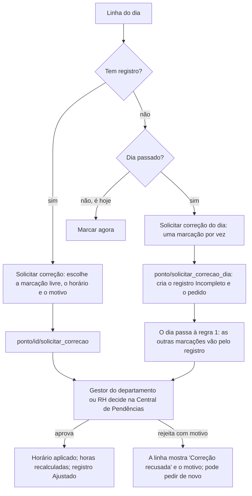

# Fluxo — espelho de ponto mensal e correção (tarefa 78)

Este fluxo descreve como o colaborador consulta os próprios registros de ponto mês a mês e como pede correção de
qualquer dia. O objetivo é não deixar brecha: todo dia tem uma situação definida, e toda situação tem um caminho.

Telas: Ponto → "Espelho de ponto" → **Mês** (`frontend/pagina_ponto.py`; regras em `frontend/ponto_mensal_modelo.py`).
Testes: `tools/testar_ponto_mensal.py`.

## 1. O que o colaborador vê

- **Mês:** do mês atual para trás, até o mês da admissão (no máximo 24 meses).
- **Resumo:** horas trabalhadas no mês, dias com marcação, dias sem registro ou incompletos e correções em análise.
- **Dias:** um por linha, da admissão até hoje. Dias futuros e anteriores à admissão não aparecem. Cada linha mostra o
  dia da semana e a data, as quatro marcações (entrada, saída para o almoço, volta e saída), o tempo trabalhado, a
  situação, uma observação e a ação possível.
- **"Baixar espelho do mês (CSV)":** gera a planilha com as mesmas colunas.

## 2. A situação de cada dia (sem sobreposição)

As regras são aplicadas nesta ordem. A primeira que valer define o dia.

| # | Quando | Situação | Ação |
|---|---|---|---|
| 1 | Existe registro de ponto no dia | Completo, Ajustado, Incompleto, ou "Em andamento" se for hoje. Registro aberto de dia passado vira **Incompleto** | "Solicitar correção" das marcações que não estão em análise |
| 2 | É hoje e não há registro | Sem marcação hoje | Nenhuma: usa "Marcar agora" no topo |
| 3 | Férias aprovadas ou concluídas cobrem o dia | Férias | Nenhuma |
| 4 | Ausência aprovada ou registrada cobre o dia | Justificado (com o tipo: atestado, falta, licença…) | Nenhuma |
| 4 | Ausência pendente cobre o dia | Ausência em análise | Nenhuma: aguarda o RH |
| 5 | Feriado nacional | Feriado (com o nome) | "Solicitar correção", para quem trabalhou |
| 6 | Sábado ou domingo | Folga | "Solicitar correção", para quem trabalhou |
| 7 | Dia útil passado, sem nada | **Sem registro** | "Solicitar correção" (esqueceu de marcar) ou "Registrar ausência ou atestado" (faltou) |

Pontos que fecham brechas:
- **Ausência recusada não justifica o dia.** O dia volta a ser "Sem registro" e pode ser corrigido.
- **Férias só pedidas não contam.** Só as aprovadas ou concluídas.
- **Feriado estadual ou municipal não muda a situação.** O backend não sabe onde a pessoa trabalha; esses dias seguem
  as regras 6 e 7.
- **Registro existente vale mais que ausência ou férias.** Se houve marcação, o dia mostra as marcações.

## 3. Correção — caminho a caminho

O que o backend confere em todo pedido:
- **Dono:** só o próprio colaborador, e não desligado.
- **Campo válido:** entrada, saída para o almoço, volta ou saída.
- **Um pedido em aberto por marcação:** a tela também tira das opções a marcação que já está em análise; com as quatro
  em análise, o botão some.
- **Horário do mesmo dia:** da meia-noite UTC do dia até as 06:00 (Brasília) do dia seguinte. A folga cobre a virada de
  data em UTC do registro (tarefa 73) e jornadas que passam da meia-noite. **Novo em 11/10/2026.**
- **Nunca no futuro.** **Novo em 11/10/2026.**
- **Ordem das marcações:** o horário pedido fica depois da marcação anterior e antes da seguinte que já existem. Isso
  impede, por exemplo, uma saída antes da entrada, que daria horas negativas. **Novo em 11/10/2026.**
- **Dia sem registro** (`ponto/solicitar_correcao_dia`, **novo**): só dia passado no horário de Brasília, não anterior
  à admissão, e sem registro já existente.
- **Quem decide:** o gestor do departamento (ou o substituto com delegação), o RH ou o Admin. Ninguém decide o próprio
  pedido. Tudo fica na auditoria.

## 4. O que fica fora (decisões, não brechas)

- **Prazo para pedir correção.** O backend não limita quantos dias atrás a pessoa pode pedir. Fechar o período depois da
  folha é uma regra de negócio a definir com o RH. Até lá, o gestor ou o RH avalia cada pedido.
- **Feriados estaduais e municipais**, pela razão do item 2.
- **Validade legal.** O registro continua sendo "controle interno experimental", e não um REP (Portaria nº 671/2021),
  como a tela já avisa.
