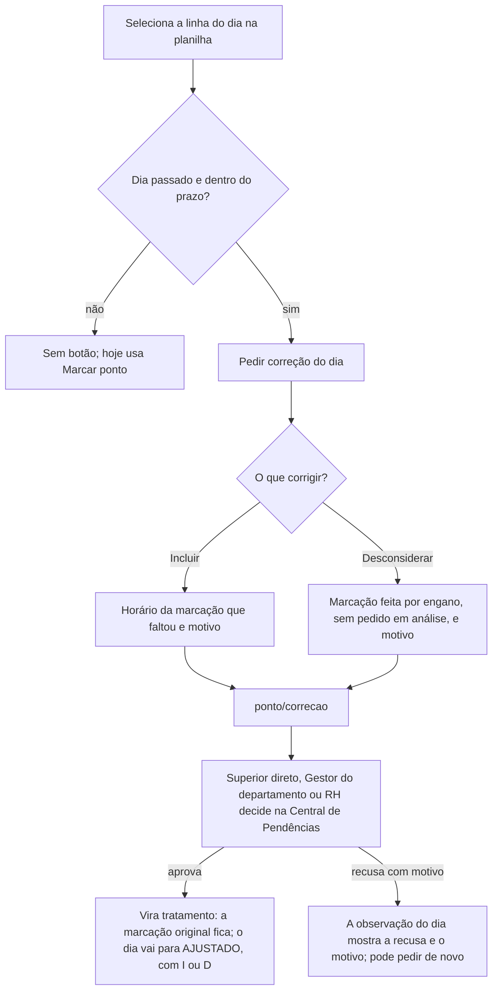

# Fluxo — espelho de ponto mensal e correção no REP-P

Este fluxo descreve como o colaborador consulta o próprio ponto mês a mês e como pede a correção de qualquer dia. O
objetivo é não deixar brecha: todo dia tem uma situação definida, e toda situação tem um caminho. Desde 12/10/2026 o
ponto segue o REP-P da Portaria MTP nº 671/2021 (change `ponto-rep-p-e-ferias-clt`). A marcação original nunca muda:
a correção aprovada vira um tratamento ao lado dela (art. 82).

Telas: Ponto → **Hoje** e **Mês** (`frontend/pagina_ponto.py`, Figma 463:825 e 464:826). Regras em
`frontend/ponto_modelo.py` e `frontend/ponto_mensal_modelo.py`. Testes em `tools/testar_ponto.py` e
`tools/testar_ponto_mensal.py`. Não há visão semanal.

## 1. O que o colaborador vê

- **Hoje:** o relógio do servidor e o botão "Marcar ponto", que funciona quantas vezes a pessoa precisar, sem ordem
  nem limite (art. 74). Abaixo, as marcações do dia em ordem, com o papel de cada uma ("Entrada", "Saída para o almoço", "Volta do almoço" e, ao fechar o
  dia, "Saída"; num dia com mais de quatro, "Saída para intervalo" e "Volta do intervalo"), com a hora, o
  NSR e o comprovante em PDF de cada uma. Também aparecem os comprovantes das últimas 48 horas (art. 80).
- **Mês:** de um seletor que vai do mês atual até o mês da **admissão**, sem limite. A tela mostra:
  - o cabeçalho do art. 84: empregador, CNPJ, local, trabalhador, CPF, admissão, cargo, horário contratual, data de
    emissão e período;
  - o resumo do mês;
  - a planilha (`st.dataframe`), com uma linha por dia.
- **Colunas da planilha:**
  - Data e dia da semana;
  - os pares "Ent. 1", "Saí. 1", "Ent. 2"…, tantos quantos o mês precisar;
  - "Desconsideradas";
  - Horas;
  - Situação.

  A marcação incluída por correção aparece como "18:05 (I)". A desconsiderada sai dos pares e vai para a própria
  coluna como "08:01 (D)", e não conta nas horas.
- **Dias em branco:** os anteriores à admissão e os que ainda não chegaram. Não têm situação, não geram falta e não
  aceitam correção.
- **"Baixar CSV":** o cabeçalho do art. 84, a planilha, a observação e o NSR de cada marcação, e a legenda.

## 2. A situação de cada dia (sem sobreposição)

As regras são aplicadas nesta ordem. A primeira que valer define o dia.

| # | Quando | Situação | Pedir correção? |
|---|---|---|---|
| 0 | Antes da admissão ou depois de hoje | Em branco | Não |
| 1 | Tem marcação ou tratamento | COMPLETO, AJUSTADO, INCOMPLETO ("· corrigir"), ou "HOJE · em jornada" | Sim, se o dia já passou |
| 2 | É hoje e não há marcação | HOJE · sem marcação | Não: usa "Marcar ponto" |
| 3 | Férias aprovadas ou concluídas | Férias | Não |
| 4 | Ausência aprovada ou registrada | Pelo tipo: Atestado, Falta justificada, Licença, Afastamento | Não |
| 4 | Ausência pendente | Ausência em análise | Não: aguarda o RH |
| 5 | Ausência recusada pelo RH | Falta injustificada | Sim, se trabalhou |
| 6 | Feriado ou ponto facultativo do calendário | "Feriado — nome" ou "Ponto facultativo — nome" | Sim, para quem trabalhou |
| 7 | Sábado ou domingo | Folga | Sim, para quem trabalhou |
| 8 | Dia útil passado, sem nada | Sem registro (mês corrente) ou Falta injustificada (mês encerrado) | Sim, ou "Registrar ausência ou atestado" |

Pontos que fecham brechas:
- **A admissão é o início.** Antes dela não há falta, nem marcação: o backend recusa a marcação e o pedido de
  correção. Sem admissão no cadastro, o início é o primeiro ponto registrado.
- **Ausência recusada não justifica o dia.** Vira "Falta injustificada" e ainda pode ser corrigida.
- **Mês encerrado.** O dia útil sem marcação nem ausência vira "Falta injustificada". No mês corrente, fica "Sem
  registro" enquanto a pessoa ainda pode resolver.
- **Férias só pedidas não contam.** Só as aprovadas ou concluídas.
- **Marcação vale mais que ausência ou férias.** Se houve marcação, o dia mostra as marcações.

## 3. Correção — caminho a caminho

O que o backend confere em todo pedido:
- **Dono:** só o próprio colaborador, e não desligado.
- **Dia:** já passou, não é anterior à admissão e está dentro do prazo do RH.
- **Inclusão:** o horário fica dentro do dia e nunca no futuro.
- **Desconsideração:** a marcação é da pessoa e daquele dia, e ainda não foi desconsiderada. Também não pode haver
  outro pedido em aberto para ela; a tela já tira essa marcação das opções.
- **Motivo:** de 5 a 150 caracteres, porque todo tratamento tem motivo.
- **Quem decide:** o superior direto ou, para quem não tem superior, o Gestor do departamento ou o substituto com
  delegação. O RH e o Admin também decidem. Ninguém decide o próprio pedido. Tudo fica na auditoria.

O gestor e o RH também podem ajustar direto, na folha da equipe (`folha_ponto/tratar`), incluindo ou desconsiderando
uma marcação com motivo. O ajuste vale na hora como tratamento, não tem prazo e avisa a pessoa.

## 4. O que fica fora (decisões, não brechas)

- **Prazo para pedir correção (tarefa 79).** O RH define o prazo na Folha de ponto; começa sem limite. Com prazo, os
  dias anteriores a hoje − prazo ficam sem o botão, marcados "Fora do prazo para pedir correção.", com um aviso acima
  da planilha. O backend recusa o pedido fora do prazo do mesmo jeito.
- **Validade legal.** Sem registro no INPI e sem assinatura ICP-Brasil, este ponto ainda não vale como REP-P para a
  fiscalização, como a tela avisa.
