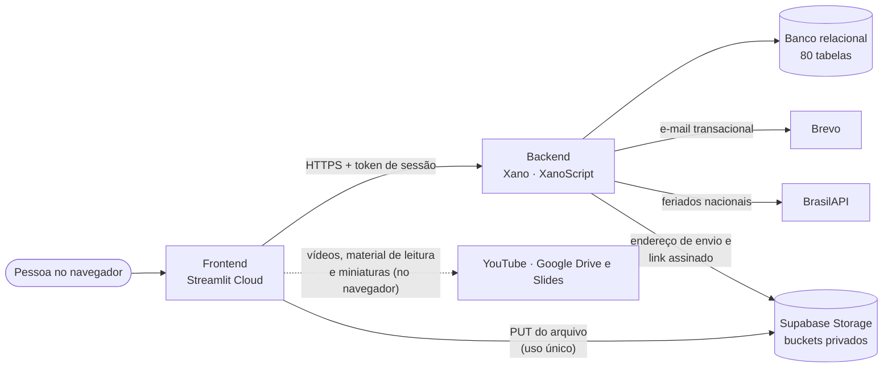

# Documentação técnica

Manual de engenharia para quem vai manter, operar ou evoluir o ConectaRH. Lido do início ao fim, dá o entendimento do projeto inteiro. Os detalhes de cada assunto ficam nos documentos citados em cada seção.

| | |
|---|---|
| **Público** | Desenvolvedores, quem assume a administração técnica, revisores e avaliadores |
| **Versão** | O `master` publicado; o site mostra a data em que foi gerado |
| **Fonte** | Este arquivo (`docs/tecnica/README.md`). O site é gerado dele por `python tools/gerar_site.py`, e os números vêm do código. |

> Para quem só vai **usar** o sistema, o documento certo é o [Manual do usuário](../usuario/manual-do-usuario.md).

## 1. Resumo

O ConectaRH reúne numa plataforma só as rotinas de RH que costumam ficar em planilhas e e-mail. Cobre o ciclo de vida do colaborador, da admissão ao desligamento:

- ponto eletrônico, férias e ausências;
- documentos, pagamento e benefícios;
- avaliações, metas, PDI e treinamentos;
- pesquisa de clima e canal de denúncias.

Há quatro perfis de acesso: **Admin, RH, Gestor e Colaborador**. Toda decisão relevante fica auditada: quem fez, o quê, quando e por quê.

| | |
|---|---|
| **Telas** | <!--n:telas-->55<!--/n-->, em 4 grupos de menu |
| **Endpoints de API** | <!--n:endpoints-->316<!--/n-->, em <!--n:grupos-->10<!--/n--> grupos |
| **Tabelas** | <!--n:tabelas-->80<!--/n--> |
| **Funções de regra no backend** | <!--n:funcoes-->48<!--/n--> |
| **Requisitos na spec** | <!--n:requisitos-->130<!--/n-->, com <!--n:cenarios-->428<!--/n--> cenários |
| **Verificações no CI** | <!--n:verificacoes_ci-->52<!--/n--> |
| **Changes entregues** | <!--n:changes-->40<!--/n--> |

**Stack:** Streamlit 1.64 (Python 3.12), Xano (XanoScript), Supabase Storage para arquivos e Brevo para e-mail.

**Estado:**
- Todas as changes planejadas estão entregues e arquivadas no OpenSpec.
- O frontend está publicado no Streamlit Community Cloud (seção 11).

> **Trabalho acadêmico**, feito em grupo. Bases legais, prazos de guarda e regras trabalhistas são referências de estudo, a confirmar com o jurídico de quem for usar o sistema de verdade.

## 2. Contexto e escopo

**Problema:** RH, gestores e colaboradores dependem de controles paralelos. Isso dificulta a rastreabilidade, a auditoria e a conformidade com a legislação trabalhista (CLT, Portaria MTP 671/2021, eSocial) e com a LGPD.

**Dentro do escopo:**

- Identidade e acesso: login em dois passos, sessões revogáveis e perfis com escopo.
- Estrutura organizacional: departamentos, cargos, níveis hierárquicos, superior direto e organograma.
- Jornada: ponto no modelo REP-P, espelho mensal, correções, banco de horas e folha de ponto da equipe.
- Férias pela CLT, ausências e desligamento.
- Documentos com campos por tipo, anexo no Supabase e documentos obrigatórios por contrato.
- Pagamento (holerites e informes anexados), benefícios e solicitações ao RH.
- Desenvolvimento: avaliações 360, ciclo anual de metas, metas e PDI da equipe, reuniões 1:1, reconhecimentos e treinamentos obrigatórios (vídeo, PDF e apresentação).
- Clima e saúde: pesquisa de clima anônima, termômetro de humor, riscos psicossociais (NR-1) e canal de denúncias (Lei 14.457/2022).
- Governança: auditoria, regras trabalhistas por contrato com exceções, pedidos LGPD, retenção e anonimização, indicadores, rotina diária e integrações.

**Fora do escopo:**

- Cálculo ou emissão de folha de pagamento: o holerite é só anexado.
- Certificação do ponto como REP-P para fiscalização.
- Decisão automática de conflitos jurídicos.
- Recrutamento.

## 3. Arquitetura



- **Frontend (`frontend/`):**
  - O app Streamlit só apresenta e coleta dados; **nunca decide** quem pode fazer o quê.
  - Cada tela é um `pagina_*.py`. As regras de apresentação ficam em módulos `*_modelo.py`, testáveis sem rede.
  - O tema, claro e escuro, está em `theme.py`. A única porta para a API é `api_client.py`.
- **Backend (`xano-workspace/`):**
  - Concentra as regras de negócio, a autorização, a auditoria e a persistência.
  - Fica versionado como arquivos `.xs` (tabelas, funções, endpoints e tarefa) e é publicado pela CLI do Xano.
- **Arquivos:**
  - O plano gratuito do Xano não aceita upload.
  - O arquivo vai do Streamlit direto para um bucket privado do Supabase (`documentos`, `fotos-perfil` e `treinamentos`), por um endereço de uso único gerado pelo Xano.
  - A leitura é sempre por link assinado de curta duração, de 5 a 10 minutos.
- **Design:** o Figma é a fonte das telas, nos temas claro e escuro.
- **Especificação:** OpenSpec em `openspec/`.

**Autenticação, em quatro passos:**

1. `auth/login` confere e-mail e senha e manda um código de 6 dígitos por e-mail. O código fica guardado como hash HMAC com *pepper*.
2. `auth/otp/validar` cria uma **sessão** e emite um token de 1 hora, que carrega o id dessa sessão.
3. **Todo endpoint autenticado** repete a mesma guarda: usuário ativo, senha definitiva e sessão ativa, não revogada e no prazo.
4. A autorização por **perfil** e por **escopo** vem depois da guarda, endpoint a endpoint. O escopo pode ser:
   - o departamento do gestor;
   - o superior direto;
   - o dono do registro;
   - uma delegação vigente;
   - o público de uma publicação.

## 4. Decisões de arquitetura

| Decisão | Por quê | Onde |
|---|---|---|
| Backend decide tudo; menu por perfil é só conveniência | O frontend roda no navegador e não é mecanismo de segurança | `AGENTS.md`, `tools/checar_endpoints.py` |
| Guarda de sessão repetida em cada endpoint, conferida no CI | O Xano não tem middleware; um verificador estático garante que nenhum endpoint fique sem guarda | `tools/checar_endpoints.py` |
| Versionamento por grupo de API, sem `/v1/` | Uma mudança incompatível cria um grupo novo | `docs/arquitetura.md` |
| Arquivos no Supabase, chave só no Xano | O plano gratuito do Xano não aceita upload; o Streamlit nunca vê a chave | change `anexo-de-arquivos` |
| Tabelas só de inclusão no ponto e no histórico | A Portaria 671/2021 pede o ARP inalterável; correção é um novo registro | `docs/ponto/rep-p.md` |
| Rotinas por data acionadas à mão | O plano gratuito não tem tarefas agendadas; RH e Admin rodam a "Rotina diária" e o `status_operacional` mostra o que está pendente | `docs/monitoramento.md` |
| Motor de regras por contrato | Jornada, banco de horas e férias vêm da matriz de contrato, sobrescrita por norma legal, instrumento coletivo ou exceção individual, com histórico | `ConectaHR/resolver_regra` |
| Hierarquia pelo superior direto | As decisões de férias, ausências e ponto seguem o superior; sem superior, decide o gestor do departamento | spec, "Autorização por perfil" |
| Estrutura da empresa e auditoria só do Admin | Separa a configuração da empresa da rotina do RH | PR #131 |
| Fontes servidas pelo próprio app | Sem Google Fonts, para não enviar o IP de quem usa a terceiros | `tools/checar_fontes_locais.py` |
| Telas começam pelo Figma; mudança funcional começa pelo OpenSpec | Mantém o desenho, a especificação e o código alinhados | `AGENTS.md` |

## 5. Atributos de qualidade

| Atributo | Como o projeto atende |
|---|---|
| **Segurança** | Guarda de sessão em todo endpoint; bloqueio de autoaprovação; senha e código com hash; alerta de acesso suspeito; sessões revogáveis; busca de segredos no CI |
| **Privacidade (LGPD)** | Mascaramento na auditoria; dado de saúde nunca chega ao gestor; conta bancária só para o titular e o RH; anonimato da pesquisa de clima e do humor; exportação dos dados do titular; anonimização de desligados (seção 14) |
| **Auditabilidade** | Toda escrita grava autor, ação, recurso, registro e resultado; abertura de arquivo sensível é registrada |
| **Acessibilidade** | Contraste de texto WCAG AA (4,5:1) conferido no CI; foco visível em todo controle; navegação por teclado; textos alternativos; tela estreita sem rolagem lateral (390 px) |
| **Manutenibilidade** | Regras de tela em módulos puros; um teste por área no CI; especificação viva no OpenSpec |
| **Disponibilidade** | Plano gratuito do Xano (10 requisições a cada 20 s); o app trata o limite com novas tentativas |

## 6. Domínio e regras de negócio

As regras implementadas estão mapeadas, com o arquivo de cada uma, em [`docs/regras-de-negocio.md`](../regras-de-negocio.md). Os conceitos estão em [`docs/domain-model.md`](../domain-model.md), e o comportamento esperado na [spec principal](../../openspec/specs/conectahr/spec.md).

| Domínio | Regras centrais |
|---|---|
| **Acesso** | Ninguém decide um pedido em que é o próprio colaborador; o gestor vê só a equipe (superior direto ou departamento); o RH não troca perfil |
| **Ponto (REP-P)** | NSR sequencial e hash SHA-256 encadeado; dia civil de Brasília; jornada aberta vira INCOMPLETO; tolerância de 10 min (CLT art. 58 §1º); descanso de 11h avisado; ajuste com motivo |
| **Férias** | Saldo do período aquisitivo; até 3 períodos, um de pelo menos 14 dias; venda de até 10 dias; início fora dos dias proibidos pelo art. 134 da CLT; conferência de conflito na equipe |
| **Documentos** | Campos por tipo, validados no backend; só PDF, JPG e PNG de até 10 MB; abertura só pelo dono, o RH e o Admin, sempre auditada; retenção por tipo |
| **Desenvolvimento** | Avaliação 360 com contestação; ciclo anual de metas em três etapas; o gestor vê, cria e faz check-in só nos liderados diretos; reuniões 1:1 com aviso |
| **Treinamentos** | Matriz de obrigatórios por setor; vídeo do YouTube conclui pelo mínimo assistido; PDF e apresentação concluem depois de abrir e confirmar a leitura |
| **Clima e denúncias** | Resposta de clima sem identidade; resultados só agregados e com número mínimo de pessoas; denúncia anônima tratada só pela comissão de ética |

## 7. Dados

O banco tem **<!--n:tabelas-->80<!--/n--> tabelas**, definidas em `xano-workspace/table/`:

| Área | Tabelas principais |
|---|---|
| Acesso e sessão | `user`, `sessao`, `solicitacao_acesso`, `preferencia_privacidade`, `preferencia_aviso` |
| Pessoas e estrutura | `colaborador`, `departamento`, `cargo`, `nivel_hierarquico`, `historico_profissional`, `historico_gestor_departamento` |
| Ponto | `marcacao_ponto` (ARP), `registro_ponto`, `tratamento_ponto`, `correcao_ponto`, `banco_horas_lancamento`, `empregador`, `feriado` |
| Férias, ausências e desligamento | `ferias`, `ausencia`, `solicitacao_desligamento`, `desligamento_checklist` |
| Documentos e pagamento | `documento`, `pendencia_documento`, `documento_obrigatorio_regra`, `beneficio`, `colaborador_beneficio` |
| Regras trabalhistas | `regra_contrato`, `regra_override`, `instrumento_normativo`, `regra_aplicada`, `contrato_especifico` |
| Desenvolvimento | `ciclo_avaliacao`, `avaliacao`, `meta_avaliacao`, `meta_checkin`, `pdi`, `reuniao_individual`, `ciclo_metas`, `formulario_meta`, `reconhecimento`, `treinamento`, `treinamento_conclusao`, `treinamento_progresso` |
| Clima, humor e denúncias | `pesquisa_clima`, `resposta_clima` (sem identidade), `resposta_clima_participacao`, `humor_*`, `denuncia`, `comissao_etica` |
| Comunicação e operação | `notificacao_interna`, `comunicado`, `artigo_faq`, `email_outbox`, `auditoria`, `configuracao`, `sla_config` |

**Convenções:**

- **Exclusão:** não há exclusão física onde existe trilha de auditoria; o padrão é arquivar ou desativar.
- **Campos sensíveis:** CPF, conta bancária e salário ficam em campos privados e são mascarados na auditoria.
- **Chaves de mapa:** nunca use `|` na chave de um `set` do XanoScript. O ponto de `uuid.webp` também aninha o mapa; leia com `get` pelo mesmo caminho.

## 8. API

São **<!--n:endpoints-->316<!--/n--> endpoints em <!--n:grupos-->10<!--/n--> grupos**, um por área, com o grupo Colaboradores como o maior:

<!--n:tabela_grupos-->
| Grupo | Endpoints |
|---|---:|
| Colaboradores | 192 |
| Ponto | 25 |
| Documentos | 21 |
| Gestão de usuários | 17 |
| Autenticação | 14 |
| Férias | 11 |
| Ausências | 10 |
| Desligamentos | 10 |
| Cargos | 9 |
| Departamentos | 7 |
<!--/n-->

- **Autenticação:** todo endpoint fora do grupo de autenticação exige o token e repete a guarda de sessão.
- **Erros:** em português, com o código HTTP certo:
  - 400 para dado inválido;
  - 401 para sessão vencida;
  - 403 para fora do perfil ou do escopo;
  - 404 para algo que não existe ou está fora do público;
  - 429 para o limite do plano.
- **Cliente:** `frontend/api_client.py` traduz tudo para `ApiError(mensagem, status)` e tenta de novo no 429.
- **Swagger:** desligado.

## 9. Configuração e segredos

Nenhum segredo fica no repositório, e o CI procura chaves versionadas a cada PR.

| Onde | Variável | Para quê |
|---|---|---|
| Xano (painel → Environment variables) | `BREVO_API_KEY` | E-mail transacional |
| Xano | `CODIGO_ACESSO_PEPPER` | Segredo do hash dos códigos de acesso |
| Xano | `SUPABASE_URL`, `SUPABASE_SERVICE_KEY` | Buckets privados de arquivos |
| Xano | `ARQUIVOS_DOMINIOS_APROVADOS` | Hosts aceitos em links de arquivo |
| Xano (opcionais) | `INDICADORES_MINIMO_PESSOAS`, `SESSAO_RETENCAO_DIAS`, `EMAIL_RETENCAO_DIAS`, `DESLIGADO_RETENCAO_DIAS` | Limites e prazos |
| Streamlit (`.streamlit/secrets.toml` ou painel) | `[xano] auth_base_url` | URL da API |

Detalhes em [`docs/deploy.md`](../deploy.md).

## 10. Ambiente de desenvolvimento

O passo a passo do zero ao primeiro Pull Request está em [`docs/primeiros-passos.md`](../primeiros-passos.md). Resumo:

```bash
python -m venv .venv && .venv\Scripts\activate
pip install -r frontend/requirements.txt
copy .streamlit\secrets.toml.example .streamlit\secrets.toml
streamlit run frontend/app.py
```

- **Backend:** publique com a CLI do Xano, **sempre com `--dry-run` antes**:

  ```bash
  xano workspace push -p ConectaRH -i "<arquivos>" --dry-run
  ```

  Antes de editar um `.xs` existente, confira se ele está igual ao que roda no Xano (`xano workspace pull`). As armadilhas do XanoScript estão em `xano-workspace/AGENTS.md`.
- **Testes:** cada `tools/testar_*.py` roda sem rede, com o `AppTest` do Streamlit e uma API simulada.

## 11. Entrega e operação

| Ambiente | Endereço | Como publica |
|---|---|---|
| Frontend | <https://conectahr-wtdxtqbzz4lyrpjv8a48nt.streamlit.app/> | O Streamlit Community Cloud republica a cada merge no `master` (Python 3.12, `frontend/app.py`) |
| Backend | Workspace do Xano (plano gratuito) | CLI: `xano workspace push`, sempre com `--dry-run` antes |
| Documentação | Este site, no GitHub Pages | O workflow `pages.yml` gera e publica a cada merge que muda `docs/` |

- **Fluxo de mudança:**
  1. Branch por tarefa.
  2. Pull Request.
  3. Pipeline **Validar** verde.
  4. Merge no `master`; não há push direto.
- **Rotina diária:** RH ou Admin aciona na tela "Rotina diária". Ela conclui desligamentos agendados, vence documentos e limpa dados com o prazo de guarda vencido. O `status_operacional` mostra o que está pendente.
- **Fila de e-mail:** `email_outbox`, com tentativas, acompanhada em "Integrações e e-mails".
- **Backup e restauração:** `xano workspace pull` guarda o código e o schema; `pull --records` guarda os dados, sempre fora do repositório. Procedimento em [`docs/monitoramento.md`](../monitoramento.md).
- **Rollback:** reverter o commit no `master`. Para o backend, publicar de novo o `.xs` anterior.

## 12. Testes realizados

**Estratégia:**

1. **Pipeline Validar, em todo PR:** <!--n:verificacoes_ci-->52<!--/n--> verificações.
   - Sintaxe de todo o Python.
   - Guarda de acesso dos endpoints, incluindo a proibição de editar as tabelas do ponto.
   - Fontes locais e contraste de texto do tema.
   - Teste de fumaça do frontend.
   - As suítes de tela, todas sem rede e sem dado real.
   - Auditoria dos seis estados de UI em todas as páginas.
   - Busca de segredos.
2. **Testes por HTTP contra o Xano real:** um caso que passa e um que falha, por perfil, com contas de teste. A montagem é temporária e desfeita no fim. Os resultados ficam em [`docs/evidencias/`](../evidencias/), sem dado pessoal.
3. **Conferência visual no Chrome:** larguras de 1440, 1000 e 390 px, temas claro e escuro, comparando com o Figma.

**Última rodada por HTTP, em 22/11/2026:**

| Assunto | Verificações |
|---|---:|
| Cards de treinamentos: criação, cards, conteúdo e conclusão por tipo | 29 de 29 |
| Metas, PDI e reuniões 1:1 da equipe, Minha equipe e reconhecimento privado | 39 de 39 |
| Estrutura da empresa e auditoria só do Admin | 18 de 18 |

**Deploy:** a tela Entrar abre no endereço publicado, com as fontes do próprio app e sem erros. O login, o Início e a saída foram conferidos ([evidência](../evidencias/deploy-streamlit-cloud.md)).

## 13. Governança e responsáveis

| Papel | Quem |
|---|---|
| Backend (Xano / XanoScript) | Leonardo dos Santos |
| Frontend (Streamlit) | Nicolas Risato |
| Apoio no backend e documentação | Matheus |
| Encarregado de dados (LGPD) | A definir |

**Processo:**

1. Toda mudança funcional começa por uma change no OpenSpec, com proposta, specs, design e tarefas.
2. Toda tela começa pelo Figma.
3. Commits e PRs citam a tarefa do `tasks.md`.
4. A change é arquivada quando todas as tarefas estão feitas.
5. Os requisitos dela entram na spec principal.

Os agentes de IA seguem o [`AGENTS.md`](../../AGENTS.md).

## 14. Limitações conhecidas, riscos e dívida técnica

| Item | Impacto | Caminho |
|---|---|---|
| Plano gratuito do Xano: 10 requisições a cada 20 s | Lentidão em picos; um POST pode passar do tempo do app e ser salvo mesmo assim | Plano pago, ou aumentar o tempo de espera do `api_client` |
| Sem tarefas agendadas | Rotinas dependem de alguém acionar | Plano pago com Background Tasks |
| Instância do Xano nos EUA | Transferência internacional de dados (LGPD) | Avaliar a região; ver [`docs/lgpd/operadores.md`](../lgpd/operadores.md) |
| Ponto sem certificação | Segue o REP-P tecnicamente, mas não vale para a fiscalização | Registro no INPI, ICP-Brasil e atestado técnico ([`docs/ponto/rep-p.md`](../ponto/rep-p.md)) |
| Bases legais e prazos de guarda | Sugestões de estudo | Confirmar com o jurídico |
| PATCH de treinamento sem tipo apaga o PDF e a capa; arquivos sem uso ficam no bucket | Só por chamada direta à API; o modal sempre manda tudo | Validar o PATCH parcial e limpar o bucket |
| RH e Admin agendam 1:1 com qualquer pessoa | Comportamento anterior às decisões D1 a D5, que tratam do gestor | Decidir se restringe |

## 15. Primeira semana de quem assume o projeto

1. Ler este documento e o [Manual do usuário](../usuario/manual-do-usuario.md).
2. Seguir os [primeiros passos](../primeiros-passos.md): rodar o app e uma suíte de teste.
3. Ler o [`AGENTS.md`](../../AGENTS.md) e o `xano-workspace/AGENTS.md`, com as regras do repositório e as armadilhas do XanoScript.
4. Percorrer o app publicado com uma conta de cada perfil.
5. Ler as [regras de negócio](../regras-de-negocio.md) da área em que vai mexer.
6. Abrir a primeira mudança pequena pelo fluxo completo: change, Figma se for tela, branch, PR e pipeline verde.

## 16. Anexos

| Assunto | Documento |
|---|---|
| Regras de negócio, com o arquivo de cada uma | [`docs/regras-de-negocio.md`](../regras-de-negocio.md) |
| Modelo de domínio | [`docs/domain-model.md`](../domain-model.md) |
| Arquitetura em uma página | [`docs/arquitetura.md`](../arquitetura.md) |
| Deploy, flags e rollback | [`docs/deploy.md`](../deploy.md) |
| Sessões, monitoramento e backup | [`docs/monitoramento.md`](../monitoramento.md) |
| Ponto REP-P | [`docs/ponto/rep-p.md`](../ponto/rep-p.md) |
| LGPD: aviso, registro de operações, RIPD, operadores, retenção e incidentes | [`docs/lgpd/`](../lgpd/) |
| Evidências dos testes | [`docs/evidencias/`](../evidencias/) |
| Spec principal | [`openspec/specs/conectahr/spec.md`](../../openspec/specs/conectahr/spec.md) |
| Histórico das changes | [`openspec/changes/archive/`](../../openspec/changes/archive/) |
| Protótipo e fluxos no Figma | [Figma do ConectaRH](https://www.figma.com/design/fph1M5tB4rA4gqfIysSmkn) |
